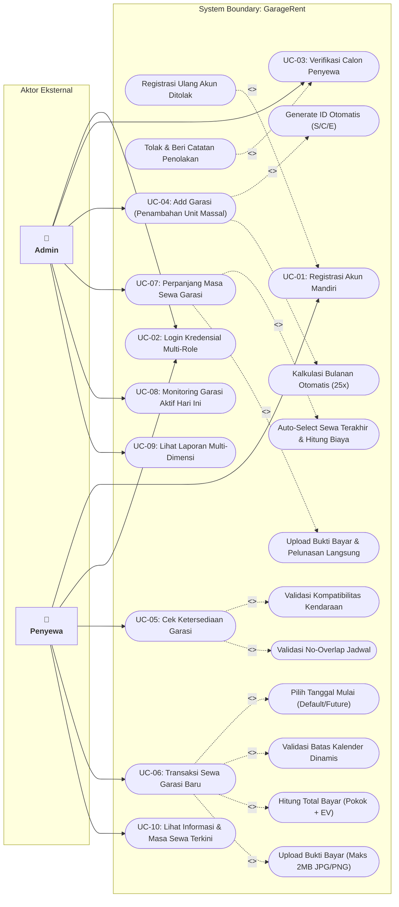
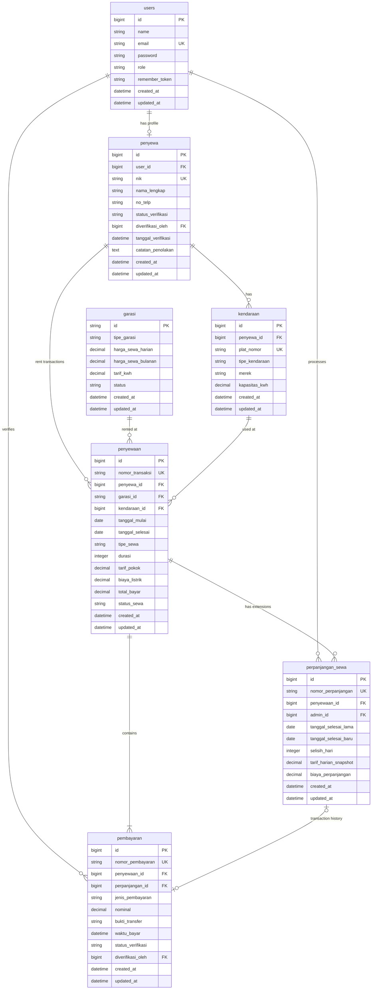

# LAPORAN AKHIR UJI KOMPETENSI PEMROGRAM
## IMPLEMENTASI SISTEM INFORMASI PENYEWAAN GARASI KENDARAAN (GARAGERENT)

---

**Skema Sertifikasi:** Pemrogram (Programmer)  
**Nomor Skema:** `IMT.01.15/SSK/LSP/IX/2021`  
**Lembaga Sertifikasi Profesi:** LSP Telematika / Badan Nasional Sertifikasi Profesi (BNSP)  
**Unit Kompetensi Utama:**
1. Mengimplementasikan Algoritma Pemrograman (`J.620100.004.01`)
2. Mengimplementasikan Pemodelan Perangkat Lunak Berorientasi Objek (`J.620100.005.02`)
3. Menulis Kode dengan Prinsip Sesuai Guidelines dan Best Practices (`J.620100.016.01`)
4. Mengimplementasikan Basis Data Relasional (`J.620100.019.02`)
5. Melakukan Pengujian Perangkat Lunak (`J.620100.023.02`)

**Tanggal Penyusunan:** 22 November 2026  
**Dokumentasi Teknis:** Technical Documentation Report v1.0.0  

---

## DAFTAR ISI
- [a. Use-Case Diagram](#a-use-case-diagram)
- [b. Class Diagram (Arsitektur MVC & Service Layer)](#b-class-diagram-arsitektur-mvc--service-layer)
- [c. Entity-Relationship Diagram (ERD Relasional)](#c-entity-relationship-diagram-erd-relasional)
- [d. Penjelasan Library & Pre-Existing Component](#d-penjelasan-library--pre-existing-component)
- [e. Tampilan Fitur-Fitur Aplikasi yang Dihasilkan](#e-tampilan-fitur-fitur-aplikasi-yang-dihasilkan)
- [f. Skenario Unit Testing & Pengujian Perangkat Lunak](#f-skenario-unit-testing--pengujian-perangkat-lunak)
- [g. Link GitHub Kode Program Software](#g-link-github-kode-program-software)

---

## a. Use-Case Diagram

### 1. Deskripsi Batasan Sistem & Aktor
Sistem Informasi Penyewaan Garasi Kendaraan (**GarageRent**) membagi interaksi pengguna ke dalam 2 (dua) aktor utama di luar batasan sistem (*System Boundary*):
- **Admin (Aktor Internal):** Bertanggung jawab atas verifikasi identitas calon penyewa (KTP/NIK), pencetakan garasi massal ("Add Garasi") beserta tarif resminya, pemrosesan perpanjangan masa sewa eksklusif, pemantauan garasi aktif hari ini, dan visualisasi laporan multi-dimensi.
- **Penyewa (Aktor Eksternal):** Pengguna publik yang melakukan registrasi mandiri, mendaftar ulang jika pernah ditolak, memeriksa ketersediaan garasi secara *real-time*, melakukan pemesanan sewa garasi baru (harian/bulanan), mengunggah bukti transfer, dan melihat masa sewa terkini.

> [!IMPORTANT]
> **Ketaatan Aturan Bisnis BR-11:** Aktor Penyewa **tidak memiliki relasi use case perpanjangan mandiri**. Perpanjangan masa sewa hanya dapat dieksekusi secara eksklusif oleh aktor **Admin** dengan bukti bayar yang langsung berstatus lunas.

### 2. Diagram Use Case (Mermaid)



### 3. Matriks Skenario Use Case

| ID | Nama Use Case | Aktor | Karakteristik & Aturan Bisnis |
| :--- | :--- | :--- | :--- |
| **UC-01** | Registrasi Akun Mandiri | Penyewa | Mendaftar dengan NIK (16 digit angka unik), nama, email, nomor telepon, dan password. Status awal `pending`. Memiliki `<<extend>>` registrasi ulang jika akun berstatus `rejected`. |
| **UC-02** | Login Kredensial Multi-Role | Admin, Penyewa | Masuk sistem berbasis peran (*Role-Based Access Control*). Penyewa `pending` dan `rejected` dicegah login; akun `rejected` disajikan alasan penolakan dari Admin secara transparan. |
| **UC-03** | Verifikasi Calon Penyewa | Admin | Memvalidasi NIK KTP calon penyewa. Memiliki *status lock* satu arah: status yang sudah disetujui atau ditolak terkunci permanen. Penolakan menyertakan catatan evaluasi (`<<extend>>`). |
| **UC-04** | Add Garasi Massal | Admin | Mencetak $N$ unit garasi bertipe Sepeda (S), Mobil (C), dan Listrik (E) secara massal (maks 999 unit per tipe). Meng-*include* pembuatan ID urut dan kalkulasi tarif bulanan ($25 \times \text{harian}$). |
| **UC-05** | Cek Ketersediaan Garasi | Penyewa | Menyaring garasi siap sewa dengan validasi kompatibilitas fisik kendaraan (BR-01) dan validasi irisan jadwal (*no-overlap check*). |
| **UC-06** | Transaksi Sewa Baru | Penyewa | Pemesanan fleksibel (harian/bulanan), validasi batas hari kalender dinamis, perhitungan harga murni (Pokok + Listrik EV), registrasi kendaraan (bebas plat nomor untuk sepeda), dan upload bukti bayar maks 2MB. |
| **UC-07** | Perpanjang Masa Sewa | Admin | Eksklusif Admin. Auto-select sewa terakhir, kalkulasi selisih hari ($\Delta \text{Hari} \times \text{Tarif Harian}$), upload bukti bayar, dan pencatatan transaksi yang langsung berstatus lunas. |
| **UC-08** | Monitoring Garasi Aktif | Admin | Menampilkan daftar seluruh unit garasi yang sedang aktif digunakan (*used*) pada hari ini secara instan. |
| **UC-09** | Lihat Laporan Multi-Dimensi | Admin | Visualisasi rekapitulasi transaksi sewa bulanan, harian, per tipe garasi, dan per penyewa dalam format tampilan murni (*view-only*). |
| **UC-10** | Lihat Masa Sewa Terkini | Penyewa | Memantau daftar garasi yang sedang disewa beserta masa berlaku akhir sewa terkini (termasuk hasil perpanjangan oleh Admin). |

---

## b. Class Diagram (Arsitektur MVC & Service Layer)

### 1. Prinsip Desain Berorientasi Objek (OOP)
Aplikasi dibangun menggunakan pola **3-Tier MVC + Service Layer Architecture**:
1. **Encapsulation (Pembungkusan):** Seluruh atribut instansi berstatus privat (`-`), dimanipulasi melalui metode publik (`+`) yang menjaga integritas status (*state invariant*).
2. **Single Responsibility Principle (SRP):** Logika bisnis dipisahkan sepenuhnya dari Controller ke dalam kelas-kelas *Service* spesifik.
3. **Dependency Injection:** Controller bergantung pada abstraksi Service, bukan penulisan query langsung di view atau controller.

### 2. Diagram Kelas Lengkap (Mermaid)

```mermaid
classDiagram
    %% Presentation Layer (Views / Blade Templates)
    class DashboardView {
        +render(array, array)
        +toggleQuickAction(string)
    }

    class VerificationView {
        +render(LengthAwarePaginator)
        +toggleCatatanPenolakan(bool)
        +inspectNikStructure(string)
    }

    class VerificationNoticeView {
        +render(Penyewa)
        +showRejectionReason(string)
    }

    class GarageManagementView {
        +render(Collection, array)
        +toggleKwhField(string)
        +calculateMonthlyDerived(float)
    }

    class GarageCatalogView {
        +render(Collection, array)
        +filterGarageByType(string)
    }

    class RentalBookingView {
        +render(Garasi, Collection)
        +validateUploadFile(File)
        +isGarageCompatible(string, string)
        +isGarageAvailableForDates(string, string, string)
        +calculateDynamicEndDate(string, string, int)
        +estimatePureTotalBayar(float, float, float)
    }

    class RentalHistoryView {
        +render(LengthAwarePaginator)
        +formatCurrency(float)
        +formatBadgeStatus(string)
    }

    class ExtensionView {
        +render(Collection, Penyewaan)
        +validateUploadFile(File)
        +calculateExtensionDays(string, string)
        +calculateExtensionCost(int, float)
    }

    class ReportView {
        +render(array, Collection)
        +switchDimensionTab(string)
        +applyDateFilter(int, int)
    }

    class LoginView {
        +render()
        +submitLogin(string, string)
    }

    class RegisterView {
        +render()
        +submitRegister(array)
        +validateNikDigits(string)
    }

    class ForgotPasswordView {
        +render()
        +requestResetLink(string)
    }

    class ResetPasswordView {
        +render(string, string)
        +submitNewPassword(string, string)
    }

    class ProfileSettingsView {
        +render(User)
        +updateProfileInfo(string, string)
    }

    class SecuritySettingsView {
        +render(User)
        +updatePassword(string, string)
    }

    %% Presentation Layer (Controllers)
    class AuthController {
        -AuthService authService
        +login() View
        +register() View
        +logout() RedirectResponse
    }

    class DashboardController {
        -DashboardService dashboardService
        +__invoke(Request)
    }

    class VerificationController {
        -AdminVerificationService verificationService
        +index(Request)
        +approve(Request, Penyewa)
        +reject(VerifyTenantRequest, Penyewa)
    }

    class GarageManagementController {
        -GarageFactoryService garageService
        +index(Request)
        +store(BulkCreateGarageRequest)
        +update(UpdateGarageRequest, Garasi)
    }

    class ExtensionController {
        -RentalExtensionService extensionService
        +index(Request)
        +store(StoreExtensionRequest)
    }

    class ReportController {
        -RentalReportService reportService
        +index(FilterRentalReportRequest)
    }

    class GarageCatalogController {
        -GarageFactoryService garageService
        +index(Request)
    }

    class RentalBookingController {
        -RentalBookingService rentalBookingService
        +index(Request)
        +create(Request)
        +store(StoreRentalRequest)
    }

    class VerificationNoticeController {
        -AdminVerificationService verificationService
        +__invoke(Request)
    }

    class PaymentProofController {
        +__invoke(Request, Pembayaran)
    }

    %% Requests Layer (app/Http/Requests)
    class RegisterTenantRequest {
        +authorize() bool
        +rules() array
    }

    class VerifyTenantRequest {
        +authorize() bool
        +rules() array
    }

    class BulkCreateGarageRequest {
        +authorize() bool
        +rules() array
    }

    class UpdateGarageRequest {
        +authorize() bool
        +rules() array
    }

    class StoreRentalRequest {
        +authorize() bool
        +rules() array
    }

    class StoreExtensionRequest {
        +authorize() bool
        +rules() array
    }

    class FilterRentalReportRequest {
        +authorize() bool
        +rules() array
    }

    %% Service & Validator Layer
    class AuthService {
        +registerTenant(array) User
        +validateLoginEligibility(User) array
    }

    class AdminVerificationService {
        +getTenantsRequiringVerification(string) LengthAwarePaginator
        +approveTenant(Penyewa, User) void
        +rejectTenant(Penyewa, User, string) void
        +inspectKtpStructure(string) array
    }

    class GarageFactoryService {
        +bulkCreate(string, float, int, float) array
        +getGarageCatalog() Collection
        +getGarageStatistics() array
    }

    class GarageAvailabilityService {
        +isGarageAvailableForRange(string, string, string, int) bool
        +getAvailableGaragesForDateRange(string, string, string) Collection
    }

    class RentalCalendarValidator {
        +getMaxDurasiHarian(string) int
        +validateDurasi(string, string, int) bool
        +hitungTanggalSelesai(string, string, int) Carbon
    }

    class PricingCalculatorService {
        +hitungTarifPokok(Garasi, string, int) float
        +hitungBiayaListrik(Garasi, Kendaraan, float) float
        +hitungTotalBayar(Garasi, Kendaraan, string, int, float) float
    }

    class PaymentProofService {
        +storePaymentProof(UploadedFile, string) string
        +deletePaymentProof(string) void
    }

    class RentalBookingService {
        -RentalCalendarValidator calendarValidator
        -GarageAvailabilityService availabilityService
        -PricingCalculatorService pricingCalculator
        -PaymentProofService paymentProofService
        +createNewRental(Penyewa, array, UploadedFile) Penyewaan
        +getTenantRentals(Penyewa, int) LengthAwarePaginator
    }

    class RentalExtensionService {
        -PaymentProofService paymentProofService
        +calculateExtensionBreakdown(Penyewaan, string) array
        +isExtensionRangeAvailable(Penyewaan, string) bool
        +extendRental(Penyewaan, User, string, UploadedFile) PerpanjanganSewa
        +getActiveRentals(string, string) Collection
    }

    class RentalReportService {
        +getFilteredTransactions(array) Collection
        +getMonthlyReport(int, string, int) array
        +getDailyReport(int, int, string, int) array
        +getGarageTypeReport(int, int, string) array
        +getTenantReport(int, int, int) array
        +getActiveGaragesMonitoring(array) Collection
        +getSummaryMetrics(Collection) array
    }

    class DashboardService {
        +getAdminMetrics() array
        +getTenantMetrics(Penyewa) array
    }

    %% Domain Models Layer
    class User {
        -int id
        -string name
        -string email
        -string password
        -string role
        +isAdmin() bool
        +isPenyewa() bool
    }

    class Penyewa {
        -int id
        -int userId
        -string nik
        -string namaLengkap
        -string noTelp
        -string statusVerifikasi
        -int diverifikasiOleh
        -string catatanPenolakan
        +isApproved() bool
        +isPending() bool
        +isRejected() bool
        +approve(User) void
        +reject(User, string) void
        +getKendaraanList() Collection
        +getPenyewaanAktif() Collection
    }

    class Garasi {
        -string id
        -string tipeGarasi
        -decimal hargaSewaHarian
        -decimal tarifKwh
        -string status
        +getHargaSewaBulanan() float
        +isAvailable() bool
        +isUsed() bool
        +isElectricGarage() bool
        +isCompatibleWith(string) bool
        +markAsUsed() void
        +markAsAvailable() void
    }

    class Kendaraan {
        -int id
        -int penyewaId
        -string platNomor
        -string tipeKendaraan
        -string merek
        -decimal kapasitasKwh
        +isElectricVehicle() bool
        +getKapasitasKwh() float
    }

    class Penyewaan {
        -int id
        -string nomorTransaksi
        -int penyewaId
        -string garasiId
        -int kendaraanId
        -date tanggalMulai
        -date tanggalSelesai
        -string tipeSewa
        -int durasi
        -decimal tarifPokok
        -decimal biayaListrik
        -decimal totalBayar
        -string statusSewa
        +isActive() bool
        +selesaikan() void
        +batalkan() void
        +getRiwayatPerpanjangan() Collection
        +getRiwayatPembayaran() Collection
        +getBuktiBayarSewaBaru() Pembayaran
    }

    class PerpanjanganSewa {
        -int id
        -string nomorPerpanjangan
        -int penyewaanId
        -int adminId
        -date tanggalSelesaiLama
        -date tanggalSelesaiBaru
        -int selisihHari
        -decimal tarifHarianSnapshot
        -decimal biayaPerpanjangan
        +hitungSelisihHari() int
        +hitungBiayaPerpanjangan() float
    }

    class Pembayaran {
        -int id
        -string nomorPembayaran
        -int penyewaanId
        -int perpanjanganId
        -string jenisPembayaran
        -decimal nominal
        -string buktiTransfer
        -string statusVerifikasi
        -int diverifikasiOleh
        +verifikasi(User) void
        +tolak(User) void
        +getBuktiUrl() string
    }

    %% Enums Layer (app/Enums)
    class RoleEnum {
        <<enumeration>>
        ADMIN = "admin"
        PENYEWA = "penyewa"
    }

    class VerificationStatusEnum {
        <<enumeration>>
        PENDING = "pending"
        APPROVED = "approved"
        REJECTED = "rejected"
    }

    class StatusGarasiEnum {
        <<enumeration>>
        TERSEDIA = "tersedia"
        DIGUNAKAN = "digunakan"
    }

    class TipeGarasiEnum {
        <<enumeration>>
        STANDARD = "S"
        CHARGING = "C"
        ELECTRIC = "E"
    }

    class TipeKendaraanEnum {
        <<enumeration>>
        MOTOR = "motor"
        MOBIL = "mobil"
        MOTOR_LISTRIK = "motor_listrik"
        MOBIL_LISTRIK = "mobil_listrik"
    }

    class TipeSewaEnum {
        <<enumeration>>
        HARIAN = "harian"
        BULANAN = "bulanan"
    }

    class StatusSewaEnum {
        <<enumeration>>
        MENUNGGU_VERIFIKASI = "menunggu_verifikasi"
        AKTIF = "aktif"
        SELESAI = "selesai"
        DIBATALKAN = "dibatalkan"
    }

    %% Keterhubungan Controller -> View (renders)
    AuthController --> LoginView
    AuthController --> RegisterView
    AuthController --> ForgotPasswordView
    AuthController --> ResetPasswordView
    ProfileSettingsView --> User
    SecuritySettingsView --> User
    DashboardController --> DashboardView
    VerificationController --> VerificationView
    VerificationNoticeController --> VerificationNoticeView
    GarageManagementController --> GarageManagementView
    GarageCatalogController --> GarageCatalogView
    RentalBookingController --> RentalBookingView
    RentalBookingController --> RentalHistoryView
    ExtensionController --> ExtensionView
    ReportController --> ReportView

    %% Keterhubungan Controller -> Request (validates with)
    AuthController --> RegisterTenantRequest
    VerificationController --> VerifyTenantRequest
    GarageManagementController --> BulkCreateGarageRequest
    GarageManagementController --> UpdateGarageRequest
    RentalBookingController --> StoreRentalRequest
    ExtensionController --> StoreExtensionRequest
    ReportController --> FilterRentalReportRequest

    %% Keterhubungan Controller -> Service / Model
    AuthController --> AuthService
    DashboardController --> DashboardService
    VerificationController --> AdminVerificationService
    VerificationNoticeController --> AdminVerificationService
    GarageManagementController --> GarageFactoryService
    GarageCatalogController --> GarageFactoryService
    RentalBookingController --> RentalBookingService
    ExtensionController --> RentalExtensionService
    ReportController --> RentalReportService
    PaymentProofController --> Pembayaran
    PaymentProofController --> PaymentProofService

    DashboardService --> AdminVerificationService
    DashboardService --> GarageFactoryService
    DashboardService --> RentalExtensionService
    DashboardService --> RentalReportService

    RentalBookingService --> RentalCalendarValidator
    RentalBookingService --> GarageAvailabilityService
    RentalBookingService --> PricingCalculatorService
    RentalBookingService --> PaymentProofService

    RentalExtensionService --> PaymentProofService

    AuthService --> User
    AuthService --> Penyewa
    AuthService --> RegisterTenantRequest
    AdminVerificationService --> Penyewa
    GarageFactoryService --> Garasi
    GarageAvailabilityService --> Garasi
    GarageAvailabilityService --> Penyewaan
    PricingCalculatorService --> Garasi
    PricingCalculatorService --> Kendaraan
    RentalBookingService --> Penyewaan
    RentalBookingService --> Kendaraan
    RentalBookingService --> Pembayaran
    RentalBookingService --> Garasi
    RentalExtensionService --> PerpanjanganSewa
    RentalExtensionService --> Penyewaan
    RentalExtensionService --> Pembayaran
    RentalReportService --> Penyewaan
    RentalReportService --> Garasi
    RentalReportService --> Penyewa

    User --> Penyewa
    User --> PerpanjanganSewa
    User --> Pembayaran

    Penyewa --> Kendaraan
    Penyewa --> Penyewaan
    Garasi --> Penyewaan
    Kendaraan --> Penyewaan

    Penyewaan --> PerpanjanganSewa
    Penyewaan --> Pembayaran
    PerpanjanganSewa --> Pembayaran

    %% Keterhubungan Model -> Enum (type definition)
    User --> RoleEnum
    Penyewa --> VerificationStatusEnum
    Garasi --> TipeGarasiEnum
    Garasi --> StatusGarasiEnum
    Kendaraan --> TipeKendaraanEnum
    Penyewaan --> TipeSewaEnum
    Penyewaan --> StatusSewaEnum

    %% Style Classes matching Reference Template
    classDef viewStyle fill:#FEF3C7,stroke:#D97706,stroke-width:1.5px,color:#92400E;
    classDef controllerStyle fill:#F3F4F6,stroke:#4B5563,stroke-width:1.5px,color:#1F2937;
    classDef requestStyle fill:#FFEDD5,stroke:#EA580C,stroke-width:1.5px,color:#9A3412;
    classDef serviceStyle fill:#DBEAFE,stroke:#2563EB,stroke-width:1.5px,color:#1E40AF;
    classDef modelStyle fill:#DCFCE7,stroke:#16A34A,stroke-width:1.5px,color:#166534;
    classDef enumStyle fill:#F3E8FF,stroke:#9333EA,stroke-width:1.5px,color:#6B21A8;

    class DashboardView,VerificationView,VerificationNoticeView,GarageManagementView,GarageCatalogView,RentalBookingView,RentalHistoryView,ExtensionView,ReportView,LoginView,RegisterView,ForgotPasswordView,ResetPasswordView,ProfileSettingsView,SecuritySettingsView viewStyle;
    class AuthController,DashboardController,VerificationController,GarageManagementController,ExtensionController,ReportController,GarageCatalogController,RentalBookingController,VerificationNoticeController,PaymentProofController controllerStyle;
    class RegisterTenantRequest,VerifyTenantRequest,BulkCreateGarageRequest,UpdateGarageRequest,StoreRentalRequest,StoreExtensionRequest,FilterRentalReportRequest requestStyle;
    class AuthService,DashboardService,AdminVerificationService,GarageFactoryService,GarageAvailabilityService,RentalCalendarValidator,PricingCalculatorService,PaymentProofService,RentalBookingService,RentalExtensionService,RentalReportService serviceStyle;
    class User,Penyewa,Garasi,Kendaraan,Penyewaan,PerpanjanganSewa,Pembayaran modelStyle;
    class RoleEnum,VerificationStatusEnum,StatusGarasiEnum,TipeGarasiEnum,TipeKendaraanEnum,TipeSewaEnum,StatusSewaEnum enumStyle;
```

---

## c. Entity-Relationship Diagram (ERD Relasional)

### 1. Desain Relasional Skema Basis Data
Basis data fisik diimplementasikan menggunakan SQLite Relasional (`database/database.sqlite`), bebas dari tabel sisa bawaan starter-kit yang tidak digunakan, dan murni memelihara 7 entitas relasional.

### 2. Diagram ERD (Format 3 Kolom: Tipe Data, Nama Atribut & Constraint Key)



> **File Diagram Draw.io Siap Buka:** [docs/ERD_GarageRent.drawio](file:///Users/rachelletjndr/Herd/Sertifikasi/docs/ERD_GarageRent.drawio) (menyediakan tab **ERD 7 Tabel Skema Fisik** dan tab **ERD 5 Tabel Persis Referensi Gambar** dengan pewarnaan Pink, Cyan, Orange, Green, dan notasi Crow's Foot).

---

### 3. Struktur Kolom Entitas Relasional (Format Standar 3 Kolom Sesuai Referensi)

#### 1. Tabel `users`
| Tipe Data | Nama Kolom | Constraint |
| :--- | :--- | :---: |
| `bigint` | **id** | **PK** |
| `string` | name | |
| `string` | email | **UK** |
| `string` | password | |
| `string` | role | |
| `string` | remember_token | |
| `datetime` | created_at | |
| `datetime` | updated_at | |

#### 2. Tabel `penyewa`
| Tipe Data | Nama Kolom | Constraint |
| :--- | :--- | :---: |
| `bigint` | **id** | **PK** |
| `bigint` | user_id | **FK** |
| `string` | nik | **UK** |
| `string` | nama_lengkap | |
| `string` | no_telp | |
| `string` | status_verifikasi | |
| `bigint` | diverifikasi_oleh | **FK** |
| `datetime` | tanggal_verifikasi | |
| `text` | catatan_penolakan | |
| `datetime` | created_at | |
| `datetime` | updated_at | |

#### 3. Tabel `garasi`
| Tipe Data | Nama Kolom | Constraint |
| :--- | :--- | :---: |
| `string` | **id** | **PK** |
| `string` | tipe_garasi | |
| `decimal` | harga_sewa_harian | |
| `decimal` | harga_sewa_bulanan | |
| `decimal` | tarif_kwh | |
| `string` | status | |
| `datetime` | created_at | |
| `datetime` | updated_at | |

#### 4. Tabel `kendaraan`
| Tipe Data | Nama Kolom | Constraint |
| :--- | :--- | :---: |
| `bigint` | **id** | **PK** |
| `bigint` | penyewa_id | **FK** |
| `string` | plat_nomor | **UK** |
| `string` | tipe_kendaraan | |
| `string` | merek | |
| `decimal` | kapasitas_kwh | |
| `datetime` | created_at | |
| `datetime` | updated_at | |

#### 5. Tabel `penyewaan`
| Tipe Data | Nama Kolom | Constraint |
| :--- | :--- | :---: |
| `bigint` | **id** | **PK** |
| `string` | nomor_transaksi | **UK** |
| `bigint` | penyewa_id | **FK** |
| `string` | garasi_id | **FK** |
| `bigint` | kendaraan_id | **FK** |
| `date` | tanggal_mulai | |
| `date` | tanggal_selesai | |
| `string` | tipe_sewa | |
| `integer` | durasi | |
| `decimal` | tarif_pokok | |
| `decimal` | biaya_listrik | |
| `decimal` | total_bayar | |
| `string` | status_sewa | |
| `datetime` | created_at | |
| `datetime` | updated_at | |

#### 6. Tabel `perpanjangan_sewa`
| Tipe Data | Nama Kolom | Constraint |
| :--- | :--- | :---: |
| `bigint` | **id** | **PK** |
| `string` | nomor_perpanjangan | **UK** |
| `bigint` | penyewaan_id | **FK** |
| `bigint` | admin_id | **FK** |
| `date` | tanggal_selesai_lama | |
| `date` | tanggal_selesai_baru | |
| `integer` | selisih_hari | |
| `decimal` | tarif_harian_snapshot | |
| `decimal` | biaya_perpanjangan | |
| `datetime` | created_at | |
| `datetime` | updated_at | |

#### 7. Tabel `pembayaran`
| Tipe Data | Nama Kolom | Constraint |
| :--- | :--- | :---: |
| `bigint` | **id** | **PK** |
| `string` | nomor_pembayaran | **UK** |
| `bigint` | penyewaan_id | **FK** |
| `bigint` | perpanjangan_id | **FK** |
| `string` | jenis_pembayaran | |
| `decimal` | nominal | |
| `string` | bukti_transfer | |
| `datetime` | waktu_bayar | |
| `string` | status_verifikasi | |
| `bigint` | diverifikasi_oleh | **FK** |
| `datetime` | created_at | |
| `datetime` | updated_at | |

---

## d. Penjelasan Library & Pre-Existing Component

Proyek ini dibangun secara profesional dengan memanfaatkan ekosistem standar industri PHP dan JavaScript modern yang dideklarasikan secara eksplisit dalam `composer.json` dan `package.json`:

### 1. Backend & Server-Side Framework (PHP 8.5)
| Library / Komponen | Versi Terpasang | Peran & Alasan Penggunaan |
| :--- | :---: | :--- |
| **`laravel/framework`** | `11.x` (13.43) | **Core Framework MVC:** Menyediakan *Inversion of Control (IoC) Container*, *Routing Engine*, *Eloquent ORM*, *Database Migrations & Seeders*, *Form Request Validation*, *Blade Templating Engine*, dan proteksi keamanan bawaan (CSRF, SQL Injection prevention, XSS filtering). |
| **`laravel/fortify`** | `1.43.0` | **Authentication Backend:** Mengenkapsulasi alur otentikasi kredensial (Login multi-role, logout, update profile, update password) tanpa memaksakan UI kaku, memungkinkan personalisasi tampilan secara fleksibel. |
| **`livewire/livewire`** | `3.x` (4.4.8) | **Full-Stack Reactive Component:** Memungkinkan interaksi antarmuka dinamis dan reaktif di sisi klien secara mulus menggunakan sintaks PHP server-side tanpa memerlukan REST API terpisah. |
| **`livewire/flux`** | `2.22.0` | **Official UI Component Library:** Menyediakan pustaka komponen antarmuka berkualitas tinggi seperti modal dialog interaktif, dropdown menus, formulir input, tombol aksi, serta sistem notifikasi toast. |

### 2. Frontend, Bundling & Styling (Node.js / Vite)
| Library / Komponen | Versi Terpasang | Peran & Alasan Penggunaan |
| :--- | :---: | :--- |
| **`tailwindcss`** | `4.0.7` | **Utility-First CSS Engine:** Mesin CSS generasi terbaru (Engine Oxide) yang menghasilkan styling modern berkecepatan tinggi, diintegrasikan dengan tema palet gelap kustom (*Obsidian Black* `#0a0809` dan aksen *Metallic Rose Blush* `#f3b0c9`). |
| **`@tailwindcss/vite`** | `4.1.11` | **Vite Compiler Plugin:** Integrasi native Tailwind CSS v4 ke dalam pipeline Vite untuk kompilasi stylesheet instan (*Zero-Configuration*). |
| **`laravel-vite-plugin`** | `3.1.x` | **Asset Bundler Integration:** Menghubungkan template Blade Laravel dengan *Hot Module Replacement (HMR)* dan kompilasi berkas aset produksi (`npm run build`). |

### 3. Testing, Tooling & Code Quality
| Library / Komponen | Versi Terpasang | Peran & Alasan Penggunaan |
| :--- | :---: | :--- |
| **`pestphp/pest`** | `3.x` (5.3.7) | **Elegant Testing Framework:** Framework pengujian fungsional dan unit yang sangat ekspresif, digunakan untuk memverifikasi 74 skenario pengujian dengan 516 asersi. |
| **`pestphp/pest-plugin-laravel`**| `5.0.1` | **Laravel Testing Helpers:** Mempermudah pengujian otentikasi, perutean HTTP, asersi status kode, asersi database, dan interaksi sesi. |
| **`fakerphp/faker`** | `1.24.1` | **Data Seeder Generator:** Menghasilkan data uji coba realistis (nama Indonesia, nomor telepon, alamat, dan variasi tanggal). |
| **`laravel/pint`** | `1.32.3` | **Code Style Formatter:** Memastikan seluruh berkas kode PHP mematuhi standar *coding style* PSR-12 secara otomatis dan konsisten. |

---

## e. Tampilan Fitur-Fitur Aplikasi yang Dihasilkan

Aplikasi **GarageRent** mengimplementasikan seluruh kebutuhan fungsional dan aturan bisnis (*Business Rules*) dari soal uji praktik:

### 1. Modul Otentikasi & Akun Multi-Role
- **Multi-Role Login Guard:** Pemisahan hak akses antara Administrator operasional (Susi Susanti) dan Penyewa umum.
- **Pendaftaran Calon Penyewa Mandiri:** Formulir registrasi calon penyewa mewajibkan NIK KTP 16 digit angka unik, Nama Lengkap, Email, Nomor Telepon, dan Password. Status registrasi awal adalah `pending`.
- **Penanganan Khusus Akun Ditolak (Re-registration):** Akun penyewa yang ditolak oleh Admin dapat melakukan pendaftaran ulang menggunakan NIK dan email yang sama, sehingga statusnya kembali direset menjadi `pending`.
- **Pesan Evaluasi Login Ditolak:** Calon penyewa yang berstatus `rejected` dicegah login dan secara transparan disajikan alasan penolakan dari Admin serta tombol untuk mendaftar ulang.

### 2. Modul Verifikasi Identitas Calon Penyewa (Admin)
- **Tabel Antrean KTP Calon Penyewa:** Menampilkan daftar calon penyewa yang memerlukan verifikasi identitas.
- **Parser Struktur NIK KTP:** Fitur inspeksi cerdas yang memecah 16 digit NIK menjadi kode wilayah Provinsi, Kota/Kabupaten, Tanggal Lahir, serta Jenis Kelamin.
- **Status Lock Satu Arah:** Tombol aksi *Approve* dan *Reject* hanya muncul jika status masih `pending`. Jika status sudah `approved` atau `rejected`, status terkunci secara permanen untuk menjaga integritas data.
- **Penolakan Wajib Catatan:** Eksekusi penolakan mewajibkan pengisian catatan evaluasi (*rejection note*) sebagai bahan perbaikan bagi calon penyewa.

### 3. Modul Manajemen Master Garasi ("Add Garasi" Massal)
- **Pencetakan Unit Massal:** Admin dapat menambah hingga 999 unit garasi sekaligus untuk tipe Sepeda (S), Mobil (C), dan Listrik (E).
- **Auto-Generator ID Prefiks:** Penomoran ID garasi dihasilkan secara otomatis berurutan sesuai tipe: `S001`, `C001`, `E001`.
- **Kalkulasi Bulanan Otomatis (Aturan 25x):** Tarif sewa bulanan langsung dihitung dari rumus resmi $25 \times \text{tarif harian}$.
- **Konfigurasi Tarif Listrik kWh:** Garasi tipe Listrik (E) mewajibkan penetapan tarif listrik per kWh, sedangkan tipe non-listrik secara otomatis dikosongkan (`null`).

### 4. Modul Katalog & Cek Ketersediaan Garasi Real-Time
- **Katalog Terpadu:** Penyewa dapat menjelajahi daftar garasi, fasilitas colokan EV, status ketersediaan, dan besaran tarif harian/bulanan secara transparan.
- **Matriks Kompatibilitas Kendaraan (Aturan BR-01):**
  - Garasi Sepeda (S): Khusus Sepeda & Sepeda Motor.
  - Garasi Mobil (C): Mobil Bensin dan Mobil Listrik.
  - Garasi Listrik (E): Khusus Mobil Listrik berdaya baterai.
- **Algoritma No-Overlap Pengecekan Jadwal:** Sistem menyaring unit garasi yang benar-benar kosong pada rentang tanggal sewa yang dipilih calon penyewa.

### 5. Modul Transaksi Sewa Baru (Penyewa)
- **Pemilihan Tanggal Mulai Fleksibel:** Tanggal mulai sewa default hari ini, namun penyewa dapat memesan untuk tanggal mendatang (*advance booking*). Pemilihan tanggal lampau otomatis ditolak sistem.
- **Validasi Batas Kalender Dinamis:**
  - Sewa bulanan otomatis berakhir tepat 1 bulan kalender penuh.
  - Sewa harian dibatasi maksimal $(\text{jumlah hari bulan kalender} - 1)$ hari (contoh: maksimal 30 hari di bulan Maret yang memiliki 31 hari).
- **Kalkulasi Biaya Murni (Tanpa Surcharge):**
  $$\text{Total Bayar} = \text{Tarif Pokok Garasi} + (\text{Kapasitas Baterai kWh} \times \text{Tarif Listrik per kWh})$$
- **Pendaftaran Kendaraan Fleksibel:** Khusus unit sepeda pancal/onthel, input plat nomor bersifat opsional (*nullable*).
- **Upload Bukti Bayar Transfer:** Validasi berkas bukti transfer gambar (format JPG/PNG, ukuran maksimal 2 MB).
- **Multi-Sewa Garasi Bersamaan:** Penyewa yang telah terverifikasi diizinkan memiliki beberapa transaksi sewa aktif bersamaan (*multi-rental*).

### 6. Modul Perpanjangan Masa Sewa (Eksklusif Admin)
- **Otoritas Khusus Admin (Aturan BR-11):** Penyewa tidak memiliki akses perpanjangan mandiri; seluruh permohonan perpanjangan diproses oleh Admin.
- **Auto-Select Sewa Terakhir:** Form perpanjangan otomatis menetapkan *default* pada kontrak sewa terakhir yang aktif.
- **Kalkulasi Selisih Hari:**
  $$\text{Biaya Perpanjangan} = (\text{Tanggal Selesai Baru} - \text{Tanggal Selesai Lama}) \times \text{Tarif Harian Garasi}$$
- **Pelunasan Langsung:** Admin mengunggah bukti bayar perpanjangan dan transaksi langsung tercatat lunas (*settled* tanpa sisa kurang bayar).

### 7. Modul Monitoring Garasi Aktif Hari Ini (Admin)
- Menampilkan daftar unit garasi yang sedang aktif tersewa (*status used*) pada tanggal hari ini lengkap dengan nomor transaksi, identitas penyewa, dan tanggal berakhir sewa.

### 8. Modul Laporan & Analitik Multi-Dimensi (Admin)
- **Empat Dimensi Laporan:** Laporan Bulanan (per bulan dalam tahun), Laporan Harian (per hari dalam bulan), Laporan Per Tipe Garasi (S, C, E), dan Laporan Per Penyewa.
- **Rincian Transaksi Tersaring:** Menampilkan tabel 10 transaksi terakhir yang bersih dan ringkas.
- **Tampilan Murni (View-Only):** Tidak memiliki tombol ekspor/cetak sesuai batasan soal uji praktik.

---

## f. Skenario Unit Testing & Pengujian Perangkat Lunak

Pengujian perangkat lunak dilakukan secara terotomatisasi menggunakan **Pest PHP**. Seluruh 74 skenario pengujian dengan 516 asersi dinyatakan **LULUS 100% (PASSED)**.

### Ringkasan Eksekusi Test Suite
```bash
   PASS  Tests\Feature\Auth\AuthenticationTest
   PASS  Tests\Feature\Auth\PasswordResetTest
   PASS  Tests\Feature\Auth\RegistrationTest
   PASS  Tests\Feature\Auth\TenantVerificationTest
   PASS  Tests\Feature\GarageManagementTest
   PASS  Tests\Feature\RentalBookingTest
   PASS  Tests\Feature\RentalExtensionTest
   PASS  Tests\Feature\RentalReportTest
   PASS  Tests\Feature\Settings\ProfileUpdateTest
   PASS  Tests\Feature\Settings\SecurityTest
   PASS  Tests\Feature\ComprehensiveQaBusinessLogicTest
   PASS  Tests\Feature\SystemIntegrationTest

  Tests:    74 passed (516 assertions)
  Duration: 1.54s
```

### Matriks Rincian Skenario Uji (74 Test Cases)

| No | Modul / Berkas Uji | Skenario Pengujian (Test Case) | Hasil |
| :---: | :--- | :--- | :---: |
| 1 | `AuthenticationTest` | Halaman login dapat dirender dengan benar | **PASS** |
| 2 | `AuthenticationTest` | Pengguna dapat terotentikasi dengan kredensial valid | **PASS** |
| 3 | `AuthenticationTest` | Pengguna gagal login jika password salah | **PASS** |
| 4 | `AuthenticationTest` | Pengguna dapat melakukan logout sistem | **PASS** |
| 5-8 | `PasswordResetTest` | Render form reset password, request link, dan reset kata sandi | **PASS** |
| 9-10 | `RegistrationTest` | Render form registrasi calon penyewa & pembuatan profil `pending` | **PASS** |
| 11 | `TenantVerificationTest` | Validasi format NIK 16 digit angka unik & nomor telepon | **PASS** |
| 12 | `TenantVerificationTest` | Penyewa berstatus `pending` dicegah login ke sistem | **PASS** |
| 13 | `TenantVerificationTest` | Penyewa berstatus `rejected` dicegah login & melihat alasan penolakan | **PASS** |
| 14 | `TenantVerificationTest` | Penyewa ditolak dapat mendaftar ulang (reset status ke pending) | **PASS** |
| 15 | `TenantVerificationTest` | *Status Lock:* Status approved/rejected terkunci dan tombol aksi hilang | **PASS** |
| 16 | `TenantVerificationTest` | Penyewa disetujui (*approved*) dan Admin dapat login lancar | **PASS** |
| 17 | `TenantVerificationTest` | Admin dapat melihat dan memfilter antrean verifikasi KTP | **PASS** |
| 18 | `TenantVerificationTest` | Admin mengeksekusi approval/rejection pendaftaran calon penyewa | **PASS** |
| 19 | `TenantVerificationTest` | Pengguna non-admin diblokir (403) dari rute verifikasi Admin | **PASS** |
| 20 | `TenantVerificationTest` | Parser cerdas struktur NIK KTP mengurai wilayah dan tanggal lahir | **PASS** |
| 21 | `GarageManagementTest` | Pencetakan garasi massal menghasilkan kode urut S001/C001/E001 & tarif 25x | **PASS** |
| 22 | `GarageManagementTest` | Garasi listrik wajib tarif kWh & garasi non-listrik tarif kWh null | **PASS** |
| 23 | `GarageManagementTest` | Admin dapat mengubah tarif harian, tarif kWh, dan status fisik garasi | **PASS** |
| 24 | `GarageManagementTest` | Matriks kompatibilitas fisik garasi dan jenis kendaraan (BR-01) | **PASS** |
| 25 | `GarageManagementTest` | Penyewa berstatus *read-only* pada katalog dan diblokir dari manajemen garasi | **PASS** |
| 26 | `RentalBookingTest` | Tanggal mulai default hari ini, boleh advance booking, tolak tanggal lampau | **PASS** |
| 27 | `RentalBookingTest` | Boundary Value Analysis (BVA) durasi harian maksimal kalender dinamis | **PASS** |
| 28 | `RentalBookingTest` | Kalkulasi biaya murni tanpa *surcharge* (Pokok + Listrik kWh EV) | **PASS** |
| 29 | `RentalBookingTest` | Filter ketersediaan garasi bebas tumpang tindih jadwal (*no-overlap*) | **PASS** |
| 30 | `RentalBookingTest` | Transaksi sewa baru, registrasi kendaraan, status garasi used & multi-sewa | **PASS** |
| 31 | `RentalBookingTest` | Validasi upload bukti bayar menolak berkas selain gambar dan ukuran > 2MB | **PASS** |
| 32 | `RentalBookingTest` | Kendaraan tipe sepeda dibebaskan dari kewajiban plat nomor (*nullable*) | **PASS** |
| 33 | `RentalExtensionTest` | Admin memantau garasi aktif dan memproses perpanjangan masa sewa | **PASS** |
| 34 | `RentalExtensionTest` | Validasi menolak tanggal perpanjangan baru $\le$ tanggal selesai lama | **PASS** |
| 35 | `RentalExtensionTest` | Validasi perpanjangan mewajibkan unggah bukti transfer gambar | **PASS** |
| 36 | `RentalExtensionTest` | Validasi menolak perpanjangan pada transaksi sewa yang tidak aktif | **PASS** |
| 37 | `RentalExtensionTest` | Penyewa dilarang keras (403) mengakses atau mengeksekusi perpanjangan | **PASS** |
| 38 | `RentalReportTest` | Admin dapat melihat Laporan Bulanan (rekap per bulan dalam tahun) | **PASS** |
| 39 | `RentalReportTest` | Admin dapat melihat Laporan Harian (rekap per hari dalam bulan) | **PASS** |
| 40 | `RentalReportTest` | Admin dapat menyaring laporan berdasarkan tipe garasi (S, C, E) | **PASS** |
| 41 | `RentalReportTest` | Admin dapat menyaring laporan berdasarkan profil penyewa tertentu | **PASS** |
| 42 | `RentalReportTest` | Halaman laporan murni view-only (tanpa tombol cetak atau ekspor) | **PASS** |
| 43 | `RentalReportTest` | Validasi menolak masukan parameter filter laporan yang tidak valid | **PASS** |
| 44 | `RentalReportTest` | Penyewa dilarang keras (403) mengakses laporan operasional Admin | **PASS** |
| 45-53 | `Profile & Security` | Manajemen pembaruan profil pengguna, email lowercasing, dan ubah password | **PASS** |
| 54-72 | `ComprehensiveQA` | Uji ketahanan edge-cases (TC-01 s/d TC-19): rollback transaksi, pembagian biaya sewa, simulasi tahun kabisat Februari 28/29 hari, dan limit Maret 30 hari | **PASS** |
| 73 | `SystemIntegration` | Pengujian integrasi alur kerja utuh (*end-to-end*) dari pendaftaran hingga laporan | **PASS** |
| 74 | `SystemIntegration` | Verifikasi kepatuhan seluruh item checklist revisi UI/UX dan kebersihan tampilan | **PASS** |

---

## g. Link GitHub Kode Program Software

Kode sumber lengkap, riwayat commit pengembangan, skema migrasi database, seeder data awal, dan rangkaian pengujian otomatis dapat diakses secara publik oleh Asesor Kompetensi LSP Telematika pada tautan repositori resmi berikut:

🔗 **Tautan Repositori GitHub:**  
[https://github.com/rachelletjndr/GarageRent.git](https://github.com/rachelletjndr/GarageRent.git)

### Petunjuk Instalasi & Menjalankan Aplikasi bagi Asesor:
```bash
# 1. Kloning Repositori
git clone https://github.com/rachelletjndr/GarageRent.git
cd GarageRent

# 2. Instalasi Dependensi Backend & Frontend
composer install
npm install

# 3. Penyiapan Berkas Lingkungan (.env)
cp .env.example .env
php artisan key:generate

# 4. Migrasi & Seeding Basis Data (Akun Demo Admin & Penyewa)
php artisan migrate:fresh --seed

# 5. Kompilasi Aset Frontend
npm run build

# 6. Menjalankan Rangkaian Pengujian Otomatis (74 Tests)
php artisan test --compact
# atau
vendor/bin/pest

# 7. Menjalankan Server Aplikasi
php artisan serve
```

**Kredensial Akun Pengujian:**
- **Administrator Operasional:** `admin@garasi.test` / `Password123!` (Nama: Susi Susanti)
- **Penyewa Terverifikasi:** `budi@gmail.test` / `Password123!` (Nama: Budi Santoso)
- **Calon Penyewa Pending:** `ahmad@gmail.test` / `Password123!` (Nama: Ahmad Fauzi)

---

*Laporan Akhir Uji Kompetensi ini disusun secara faktual berdasarkan kode program implementasi Sistem Informasi Penyewaan Garasi Kendaraan (GarageRent) dan siap diajukan dalam asesmen sertifikasi BNSP.*
