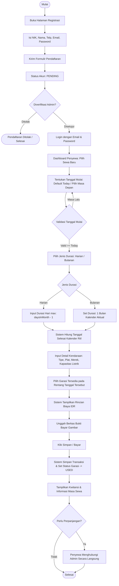
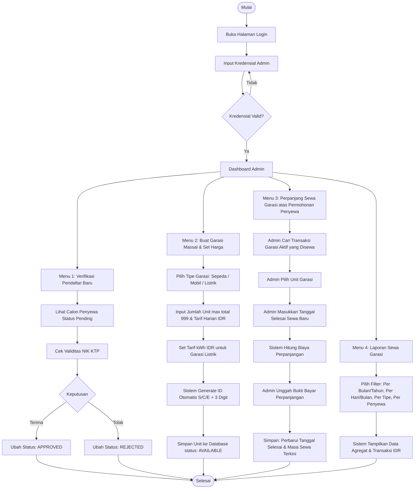

# SOFTWARE REQUIREMENT SPECIFICATION (SRS)
## SISTEM INFORMASI PENYEWAAN GARASI KENDARAAN (SIM-GARASI)

---

**Nomor Dokumen:** SRS-SIM-GARASI-2026-001  
**Versi Dokumen:** 1.2.0 (Formula Tarif Bulanan Tetap 25x Harian & Total Bayar Sewa Baru Murni Tanpa Biaya Tambahan)  
**Tanggal Rilis:** 21 November 2026  
**Status:** Disetujui untuk Tahap Desain, Pemodelan UML, & Implementasi  
**Penyusun:** System Analyst & Software Architect  
**Referensi Standar:** Skema Sertifikasi Pemrogram BNSP / LSP Telematika (Nomor: IMT.01.15/SSK/LSP/IX/2021)  
**Dokumen Induk:** Lembar Instruksi Terstruktur FR.IA.04A (Asesor: Citra Lestari) & Addendum Ketentuan Sistem Penyewaan  

---

### DAFTAR ISI
1. [Project Overview](#1-project-overview)
2. [User Roles dan Hak Akses](#2-user-roles-dan-hak-akses)
3. [Functional Requirements (Kebutuhan Fungsional)](#3-functional-requirements-kebutuhan-fungsional)
4. [Business Rules (Aturan Bisnis Eksplisit)](#4-business-rules-aturan-bisnis-eksplisit)
5. [Non-Functional Requirements (Kebutuhan Non-Fungsional)](#5-non-functional-requirements-kebutuhan-non-fungsional)
6. [User Flow (Alur Pengguna)](#6-user-flow-alur-pengguna)
7. [Validation Rules (Aturan Validasi Input)](#7-validation-rules-aturan-validasi-input)
8. [Acceptance Criteria (Kriteria Keberhasilan & Pengujian Unit)](#8-acceptance-criteria-kriteria-keberhasilan--pengujian-unit)
9. [Matriks Ketertelusuran (Traceability Matrix)](#9-matriks-ketertelusuran-traceability-matrix)
10. [Klasifikasi: Requirement Asli vs Asumsi Desain](#10-klasifikasi-requirement-asli-vs-asumsi-desain)

---

## 1. Project Overview

### 1.1 Nama Aplikasi
Aplikasi ini bernama resmi **Sistem Informasi Penyewaan Garasi Kendaraan** dengan singkatan **SIM-Garasi** (*Vehicle Garage Rental Information System*).

### 1.2 Latar Belakang Sistem
Perusahaan penyedia jasa sewa ruang parkir dan garasi kendaraan menghadapi tantangan operasional dalam mengelola ratusan unit garasi yang memiliki spesifikasi fisik dan infrastruktur berbeda:
1. Perbedaan penanganan unit antara sepeda/sepeda motor, mobil berbahan bakar bensin/konvensional, dan mobil listrik (*Electric Vehicle* / EV).
2. Adanya infrastruktur pengisian daya listrik (*EV charging*) pada garasi khusus mobil listrik yang mewajibkan pengisian daya hingga penuh, sehingga menuntut integrasi perhitungan tarif sewa dan biaya konsumsi listrik berbasis kapasitas baterai (kWh).
3. Kompleksitas penentuan durasi sewa kalender riil: sistem harus menghitung durasi bulanan berdasarkan kalender aktual (termasuk tahun kabisat) dan membatasi sewa harian maksimal $(\text{jumlah hari bulan terkait} - 1)$ hari, dengan batasan maksimal 1 kali transaksi adalah 1 bulan kalender.
4. Fleksibilitas penjadwalan sewa: pengguna dapat memesan jauh-jauh hari (*advance booking*) dengan tanggal mulai *default* hari ini tanpa mengizinkan tanggal masa lalu (*past date*).
5. Pengendalian proses perpanjangan masa sewa (*extension*) yang disentralisasi melalui Admin guna mencegah perubahan sepihak, verifikasi pembayaran perpanjangan, serta penyusunan laporan keuangan terpadu berbasis mata uang Rupiah (IDR).

Oleh karena itu, dibutuhkan sebuah perangkat lunak berbasis web/mobile terpadu yang memadukan prinsip pemrograman berorientasi objek (OOP), pemrograman terstruktur, integritas basis data relasional, serta pelaporan multi-dimensi.

### 1.3 Tujuan Aplikasi
1. **Otomatisasi Manajemen Inventaris Garasi:** Memfasilitasi pembuatan unit garasi secara massal (*bulk*) dengan pengkodean otomatis yang konsisten (`S001`-`S999`, `C001`-`C999`, `E001`-`E999`).
2. **Pengendalian Alokasi Sesuai Jenis Kendaraan:** Menegakkan aturan penempatan jenis kendaraan ke tipe garasi yang valid guna mencegah kesalahan alokasi fisik.
3. **Penyederhanaan dan Fleksibilitas Transaksi:** Mempermudah penyewa dalam memesan sewa garasi secara *real-time* atau terjadwal di masa depan, memilih durasi harian/bulanan kalender aktual, dan mengunggah bukti bayar.
4. **Sentralisasi Kendali Perpanjangan:** Memberikan otoritas eksklusif kepada Admin untuk memperbarui masa sewa penyewa, mencatat bukti pembayaran perpanjangan, dan memelihara status garasi.
5. **Akurasi Perhitungan Finansial dalam Rupiah (IDR):** Mengotomatisasi kalkulasi tarif sewa berbasis kalender aktual, tarif bulanan tetap otomatis ($25 \times \text{tarif harian}$), biaya isi daya EV penuh, serta perhitungan biaya perpanjangan sewa.
6. **Akuntabilitas & Audit Trail:** Menyediakan modul verifikasi identitas penyewa baru oleh Admin serta tampilan laporan sewa garasi multi-dimensi (tahunan, bulanan, harian, per tipe, dan per penyewa).

### 1.4 Ruang Lingkup Aplikasi
- **Platform:** Web Application (Arsitektur MVC berbasis Laravel / PHP 8.5) dengan antarmuka responsif, terhubung ke *Relational Database Management System* (MySQL/PostgreSQL/SQLite).
- **Mata Uang:** Seluruh nominal tarif dan transaksi menggunakan mata uang Rupiah (**IDR**).
- **Modul Utama:**
  - Modul Autentikasi dan Manajemen Akun (Pendaftaran & Verifikasi KTP).
  - Modul Manajemen Master Garasi (Pembuatan Massal, Penetapan Tarif Harian & Listrik IDR oleh Admin, Perhitungan Otomatis Tarif Bulanan 25x Harian, Kodefikasi Otomatis).
  - Modul Transaksi Sewa Baru (Katalog Ketersediaan Rentang Tanggal, Penjadwalan Tanggal Mulai, Validasi Durasi Kalender, Kalkulasi Biaya Transparan, Upload Bukti Bayar).
  - Modul Perpanjangan Masa Sewa (Dikelola oleh Admin atas permohonan penyewa, Perubahan Tanggal Akhir, Perhitungan Biaya Perpanjangan, Bukti Bayar Perpanjangan).
  - Modul Laporan & Analitik Penyewaan (Multi-Dimensi).
- **Batasan Sistem (Out of Scope):**
  - Penyewa **tidak memiliki akses** untuk memperpanjang masa sewa secara mandiri melalui aplikasi (harus melalui Admin).
  - Sistem tidak terintegrasi langsung dengan payment gateway otomatis perbankan (*mocking* verifikasi pembayaran dilakukan manual melalui unggah bukti transfer).
  - Sistem tidak membaca sensor meteran listrik IoT secara *real-time*; konsumsi listrik dihitung dari kapasitas baterai kendaraan yang diisi hingga penuh saat sewa baru.

---

## 2. User Roles dan Hak Akses

Sistem mendefinisikan 2 (dua) peran pengguna utama dengan skema kendali akses berbasis peran (*Role-Based Access Control* / RBAC):

```
       +-------------------------------------------------------+
       |                   SIM-GARASI SYSTEM                   |
       +-------------------------------------------------------+
                    /                             \
                   /                               \
        [Role: Admin]                     [Role: Penyewa]
              |                                  |
     - Verifikasi Penyewa Baru          - Registrasi Akun Mandiri
     - Bulk Creation Garasi             - Sewa Baru Garasi (Harian / 1 Bln)
     - Penetapan Harga Harian & kWh     - Pemilihan Tanggal Mulai (>= Today)
     - Kelola Perpanjangan Sewa (Eksklusif)- Cek Ketersediaan Garasi
     - Monitoring Garasi Aktif          - Upload Bukti Bayar Sewa Baru
     - Laporan Sewa Multi-Dimensi       - Melihat Informasi Masa Sewa & Riwayat
```

### 2.1 Role Admin
Admin adalah petugas operasional pengelola garasi.
**Hak Akses:**
1. Melakukan autentikasi (Login & Logout).
2. Melihat daftar calon penyewa berstatus `pending` dan memverifikasi (menerima/menolak) pendaftaran berdasarkan validitas KTP.
3. Membuat unit-unit garasi baru secara massal (*bulk*) berdasarkan tipe dengan kalkulasi ID otomatis serta menetapkan tarif sewa harian dan tarif listrik per kWh saja (seluruhnya dalam IDR); sistem secara otomatis menghitung harga sewa bulanan ($25 \times \text{tarif harian}$).
4. Melihat daftar seluruh garasi yang sedang aktif disewa (`used`) pada tanggal berjalan (hari ini) beserta detail masa sewanya.
5. **Memproses Perpanjangan Masa Sewa (Eksklusif):** Menerima pengajuan perpanjangan dari penyewa, memperbarui tanggal akhir masa sewa di sistem, menghitung biaya perpanjangan, dan mengunggah berkas bukti pembayaran perpanjangan.
6. Mengakses, melihat, dan memfilter laporan penyewaan (tahunan, bulanan, harian, tipe garasi, penyewa) langsung di layar aplikasi.

### 2.2 Role Penyewa (Tenant)
Penyewa adalah pelanggan yang menyewa unit garasi untuk kendaraannya.
**Hak Akses:**
1. Mendaftarkan diri secara mandiri dengan mengisi biodata lengkap dan NIK KTP.
2. Melakukan autentikasi (Login & Logout) setelah akun disetujui (`approved`) oleh Admin.
3. Melihat daftar unit garasi yang berstatus `available` pada rentang tanggal sewa yang diinginkan sesuai kompatibilitas tipe kendaraannya.
4. Melihat tarif sewa harian yang ditetapkan Admin dan tarif bulanan hasil perhitungan otomatis sistem ($25 \times \text{harian}$) dalam IDR (penyewa hanya bersifat *read-only* terhadap tarif).
5. Melakukan transaksi Sewa Baru:
   - Menentukan tanggal mulai sewa (default hari ini, dapat memilih tanggal masa depan, dilarang tanggal masa lalu).
   - Memilih jenis durasi: Harian (maksimal hari kalender bulan tersebut - 1) atau Bulanan (maksimal 1 bulan kalender aktual).
   - Memasukkan data spesifikasi kendaraan yang akan diparkir.
   - Melihat rincian total biaya sewa secara transparan (Tarif Pokok Sewa + Biaya Listrik jika ada).
   - Mengunggah berkas gambar bukti pelunasan biaya sewa baru.
6. Menyewa lebih dari satu garasi secara bersamaan (multi-sewa).
7. Melihat riwayat transaksi sewa dan memantau informasi masa sewa terbaru (termasuk hasil perpanjangan yang telah diperbarui Admin).
8. *Catatan:* Penyewa **tidak memiliki akses/tombol perpanjangan mandiri** pada aplikasi; perpanjangan wajib dilakukan dengan menghubungi Admin.

### 2.3 Matriks Aksesibilitas Fitur (Access Control Matrix)

| Modul / Fitur | Tamu (Guest) | Penyewa (Pending) | Penyewa (Approved) | Admin |
| :--- | :---: | :---: | :---: | :---: |
| Registrasi Akun Mandiri | Ya | Tidak | Tidak | Tidak |
| Login Sistem | Ya | Ditolak (Notif) | Ya | Ya |
| Cek Garasi Tersedia | Tidak | Tidak | Ya | Ya |
| Transaksi Sewa Baru (Pemesanan) | Tidak | Tidak | Ya | Tidak |
| Pilih Tanggal Mulai (Default Today / Future) | Tidak | Tidak | Ya | Tidak |
| Upload Bukti Bayar Sewa Baru | Tidak | Tidak | Ya | Tidak |
| Lihat Riwayat & Masa Sewa Terbaru | Tidak | Tidak | Ya | Ya |
| Verifikasi Pendaftar Baru (KTP) | Tidak | Tidak | Tidak | Ya |
| Pembuatan Garasi Massal & Set Harga IDR | Tidak | Tidak | Tidak | Ya |
| Lihat Daftar Garasi Aktif Hari Ini | Tidak | Tidak | Tidak | Ya |
| **Proses Perpanjangan Masa Sewa** | **Tidak** | **Tidak** | **Tidak (Hubungi Admin)** | **Ya (Eksklusif)** |
| Upload Bukti Bayar Perpanjangan | Tidak | Tidak | Tidak | Ya |
| Akses Seluruh Laporan Sewa | Tidak | Tidak | Tidak | Ya |

---

## 3. Functional Requirements (Kebutuhan Fungsional)

### FR-01: Registrasi Penyewa Mandiri
- **Deskripsi:** Calon penyewa mendaftarkan akun secara mandiri melalui formulir registrasi publik.
- **Input Data:**
  - NIK KTP (16 digit angka numerik).
  - Nama Lengkap (string, max 100 karakter).
  - Nomor Telepon / WhatsApp aktif (string numerik, 10-15 digit).
  - Alamat Email (format email valid, unik).
  - Password (string, minimal 8 karakter).
- **Proses:**
  - Validasi keunikan NIK dan Email.
  - Enkripsi password menggunakan algoritma hashing aman (`bcrypt`).
  - Menyimpan data calon penyewa dengan status verifikasi `pending`.
- **Output:** Pesan notifikasi registrasi berhasil dan instruksi menunggu verifikasi berkas/identitas oleh Admin.

### FR-02: Login dan Autentikasi Multi-Role
- **Deskripsi:** Pengguna masuk ke sistem menggunakan kredensial email dan password terdaftar.
- **Proses:**
  - Memeriksa kecocokan kredensial.
  - Memeriksa status pendaftaran: jika role penyewa dan berstatus `pending`, sistem menolak sesi masuk dan menampilkan pesan bahwa akun sedang menunggu persetujuan Admin.
  - Jika akun `rejected`, sistem menampilkan alasan penolakan.
  - Jika akun `approved` atau role `Admin`, sistem mengarahkan (*redirect*) pengguna ke dashboard masing-masing role.
- **Output:** Sesi autentikasi aktif (*authenticated state*).

### FR-03: Verifikasi Pendaftaran oleh Admin
- **Deskripsi:** Admin memeriksa daftar pendaftaran calon penyewa baru untuk memvalidasi identitas.
- **Input:** ID Calon Penyewa, Aksi (`Terima` / `Tolak`), Catatan penolakan (opsional).
- **Proses:**
  - Admin membuka menu verifikasi pendaftar.
  - Sistem menampilkan data calon penyewa berstatus `pending`.
  - Jika diterima: status akun diubah menjadi `approved`.
  - Jika ditolak: status akun diubah menjadi `rejected`.
- **Output:** Status pengguna diperbarui dalam basis data, calon penyewa yang disetujui memperoleh izin login dan melakukan transaksi.

### FR-04: Pembuatan Garasi Secara Massal (Bulk Creation) & Penetapan Harga
- **Deskripsi:** Admin dapat memproduksi sejumlah unit garasi baru dalam satu proses eksekusi serta menetapkan harga resmi.
- **Input Data:**
  - Tipe Garasi: `Sepeda`, `Mobil`, atau `Mobil Listrik`.
  - Jumlah Garasi: Angka bulat positif (maksimal sisa kapasitas menuju batas 999 unit per tipe).
  - Harga Sewa Harian: Nominal Rupiah (IDR) $> 0$ (diinput oleh Admin).
  - Harga Sewa Bulanan: Dihitung secara otomatis oleh sistem ($25 \times \text{Harga Sewa Harian}$) dan ditampilkan sebagai nilai *read-only* (tidak diinput oleh Admin).
  - Harga Isi Listrik per kWh: Nominal Rupiah (IDR) $> 0$ (wajib diisi khusus untuk Tipe Garasi `Mobil Listrik`).
- **Proses:**
  - Sistem mencari nomor urut terakhir pada tipe garasi tersebut.
  - Sistem menghasilkan ID secara berurutan (*incremental*) dengan format:
    - Sepeda: `S` + 3 digit (`S001` - `S999`)
    - Mobil: `C` + 3 digit (`C001` - `C999`)
    - Mobil Listrik: `E` + 3 digit (`E001` - `E999`)
  - Setiap unit disimpan ke basis data dengan status default `available`.
- **Output:** Unit-unit garasi baru tersimpan dalam basis data relasional dengan harga resmi IDR.

### FR-05: Pengecekan Ketersediaan Garasi Real-Time & Terjadwal
- **Deskripsi:** Sistem menyaring unit garasi yang siap disewa berdasarkan kompatibilitas kendaraan dan rentang tanggal pemesanan.
- **Input:** Tipe Kendaraan, Tanggal Mulai Sewa, Tanggal Selesai Sewa.
- **Proses:**
  - Evaluasi unit garasi yang bertipe cocok:
    - Sepeda / Motor $\rightarrow$ Garasi Sepeda (`S`).
    - Mobil Bensin $\rightarrow$ Garasi Mobil (`C`).
    - Mobil Listrik $\rightarrow$ Garasi Mobil (`C`) atau Garasi Mobil Listrik (`E`).
  - Pengecekan overlap jadwal sewa: Garasi dianggap `available` pada rentang $[T_{\text{mulai}}, T_{\text{selesai}}]$ jika tidak ada transaksi aktif lain yang beririsan dengan rentang tanggal tersebut.
- **Output:** Daftar unit garasi (ID Garasi, Tipe, Tarif Harian IDR, Tarif Bulanan IDR, Fasilitas Listrik).

### FR-06: Sewa Garasi Baru (Pemesanan Mandiri oleh Penyewa)
- **Deskripsi:** Penyewa terverifikasi melakukan pemesanan sewa unit garasi baru.
- **Input Data:**
  - Tanggal Mulai Sewa:
    - Nilai *default*: Hari ini (`current_date`).
    - Fleksibilitas: Pengguna dapat mengubah ke tanggal masa depan (*advance booking*).
    - Batasan: Sistem melarang pemilihan tanggal di masa lalu (*past date* ditolak).
  - Durasi Sewa:
    - Jenis Durasi Sewa: Pilihan antara `Harian` atau `Bulanan`.
    - Durasi Sewa Harian: Input angka hari dengan batas maksimal $(\text{jumlah hari bulan kalender terkait} - 1)$ hari.
    - Durasi Sewa Bulanan: Tepat 1 bulan kalender (maksimal durasi dalam satu kali transaksi pemesanan).
  - Data Kendaraan: Plat Nomor, Jenis/Tipe Kendaraan, Merek, Kapasitas Baterai kWh (khusus mobil listrik).
  - Pilihan Unit Garasi: Dipilih dari daftar garasi yang berstatus `available` pada rentang tanggal sewa.
- **Proses:**
  - Sistem menghitung Tanggal Selesai Sewa:
    - Jika Harian: $\text{Tanggal Selesai} = \text{Tanggal Mulai} + (\text{Durasi Hari} - 1)\text{ hari}$.
    - Jika Bulanan: $\text{Tanggal Selesai} = \text{Tanggal Mulai} + 1\text{ bulan kalender}$ (menyesuaikan hari riil bulan kalender, misal: mulai 15 Februari 2026 selesai 14 Maret 2026, durasi = 28 hari kalender aktual).
  - Sistem memvalidasi ketersediaan garasi pada interval tanggal tersebut.
  - Sistem menghitung total rincian biaya sewa baru (lihat FR-07).
  - Setelah berkas bukti pembayaran diunggah (FR-08) dan transaksi disimpan, sistem mengubah status garasi menjadi `used` untuk rentang sewa tersebut.
- **Output:** Nomor transaksi pemesanan baru dan pembaruan status garasi.

### FR-07: Perhitungan Biaya Sewa Baru
- **Deskripsi:** Sistem menghitung total tagihan sewa baru dalam Rupiah (IDR) secara transparan dan deterministik tanpa penambahan biaya lain.
- **Komponen Perhitungan:**
  1. *Tarif Pokok Sewa (IDR):*
     - Harian: $\text{Tarif Harian} \times \text{Jumlah Hari}$.
     - Bulanan: $\text{Tarif Pokok Bulanan} = 25 \times \text{Tarif Harian}$ (dihitung otomatis oleh sistem).
  2. *Biaya Pengisian Listrik (Khusus Mobil Listrik di Garasi Mobil Listrik 'E'):*
     - $\text{Biaya Listrik} = \text{Kapasitas Baterai (kWh)} \times \text{Harga Listrik per kWh (IDR)}$.
     - *(Jika mobil listrik di garasi mobil bensin 'C', biaya listrik = Rp 0).*
  3. *Total Bayar Sewa Baru (IDR):*
     - Total Bayar sewa baru sama persis dengan total biaya sewa tanpa tambahan biaya lain:
       $$\text{Total Bayar} = \text{Tarif Pokok Sewa} + \text{Biaya Listrik}$$
- **Output:** Rincian biaya ditampilkan secara terperinci kepada penyewa sebelum konfirmasi simpan.

### FR-08: Upload Bukti Pembayaran
- **Deskripsi:** Pengguna mengunggah berkas gambar bukti transfer pelunasan biaya sewa.
- **Input:** File gambar bukti transfer (`.jpg`, `.jpeg`, `.png`, max 2MB).
- **Proses:**
  - Sistem memvalidasi ekstensi dan ukuran berkas.
  - Sistem melakukan sanitasi penamaan berkas unik berbasis timestamp dan hash (`proof_transaksi_[uuid].[ext]`).
  - Berkas disimpan pada direktori penyimpanan aman (*storage/app/public/payments/*) dan path-nya direkam di basis data.
- **Output:** Berkas tersimpan dan terhubung ke entitas transaksi sewa.

### FR-09: Perpanjangan Masa Sewa Garasi (Dikelola Eksklusif oleh Admin)
- **Deskripsi:** Admin memperpanjang durasi sewa atas permohonan penyewa yang menghubungi Admin.
- **Aktor:** Admin (Penyewa tidak memiliki akses eksekusi perpanjangan mandiri).
- **Input Data:**
  - ID Transaksi Sewa Aktif / Pilihan Unit Garasi.
  - Tanggal Selesai Baru: Wajib lebih besar dari Tanggal Selesai Sebelumnya ($\text{Tanggal Selesai Baru} > \text{Tanggal Selesai Lama}$).
  - File Bukti Pembayaran Biaya Perpanjangan.
- **Proses:**
  - Admin mencari dan memilih garasi yang sedang aktif disewa penyewa.
  - Admin memasukkan tanggal perpanjangan masa sewa baru.
  - Sistem menghitung selisih hari perpanjangan: $\Delta \text{Hari} = \text{Tanggal Selesai Baru} - \text{Tanggal Selesai Lama}$.
  - Sistem menghitung biaya tambahan perpanjangan berdasarkan tarif sewa harian:
    $$\text{Biaya Perpanjangan (IDR)} = \Delta \text{Hari} \times \text{Tarif Harian Garasi}$$
  - Admin mengunggah berkas bukti transfer pelunasan biaya perpanjangan.
  - Sistem memperbarui tanggal selesai sewa transaksi dan mencatat riwayat perpanjangan.
- **Output:** Data sewa terperbarui, informasi masa sewa terbaru ditampilkan ke sistem (dapat dilihat oleh Penyewa maupun Admin), status garasi tetap `used` hingga tanggal baru tercapai.

### FR-10: Pelaporan Penyewaan Multi-Dimensi
- **Deskripsi:** Admin melihat laporan rekapitulasi penyewaan garasi untuk kebutuhan analitik dan pembukuan dalam mata uang IDR.
- **Filter Laporan:**
  1. *Laporan Bulanan:* Rekapitulasi sewa per bulan dalam tahun tertentu.
  2. *Laporan Harian:* Rekapitulasi sewa per hari dalam bulan tertentu.
  3. *Laporan Berdasarkan Tipe Garasi:* Sepeda (`S`), Mobil (`C`), atau Listrik (`E`).
  4. *Laporan Berdasarkan Penyewa:* Riwayat transaksi spesifik per penyewa.
- **Fitur Khusus Monitoring:** Tampilan instan daftar seluruh unit garasi yang sedang aktif disewa (`used`) pada tanggal hari ini.
- **Output:** Tabel tabular interaktif dengan fitur filter dan total pendapatan akumulatif (IDR) yang ditampilkan di layar aplikasi.

---

## 4. Business Rules (Aturan Bisnis Eksplisit)

Semua aturan bisnis di bawah ini bersifat mengikat dan wajib diterapkan pada logika domain:

```
+-------------------------------------------------------------------------------------------------------+
|                                      ATURAN BISNIS SIM-GARASI                                         |
+-------------------------------------------------------------------------------------------------------+
| KODE   | NAMA ATURAN BISNIS              | FORMULASI / KETENTUAN LOGIS                                |
+--------+---------------------------------+------------------------------------------------------------+
| BR-01  | Kompatibilitas Kendaraan        | Sepeda/Motor -> Garasi Sepeda ('S')                        |
|        |                                 | Mobil Bensin -> Garasi Mobil ('C')                         |
|        |                                 | Mobil Listrik -> Garasi Mobil ('C') ATAU Listrik ('E')     |
+--------+---------------------------------+------------------------------------------------------------+
| BR-02  | Pengisian Listrik EV Penuh      | Mobil Listrik di Garasi 'E' WAJIB isi daya penuh           |
|        |                                 | Biaya Listrik = Kapasitas (kWh) * Tarif Listrik per kWh    |
|        |                                 | Mobil Listrik di Garasi 'C' TIDAK ada biaya listrik        |
+--------+---------------------------------+------------------------------------------------------------+
| BR-03  | Ketentuan Harga Sewa (IDR)      | Seluruh harga dalam Rupiah (IDR). Admin input tarif harian  |
|        | & Formula Bulanan Tetap         | & kWh listrik. Tarif bulanan otomatis = 25 * harian (tetap).|
+--------+---------------------------------+------------------------------------------------------------+
| BR-04  | Batas Maksimal Durasi Pemesanan | Maksimal durasi 1 kali pemesanan adalah 1 BULAN KALENDER.  |
|        | & Sewa Harian Dinamis           | 1 Bulan kalender mengikuti bulan aktual (termasuk kabisat).|
|        |                                 | Maksimal Sewa Harian = (Jumlah Hari Bulan Terkait) - 1 hari|
|        |                                 | Feb 2026: maks 27 hari; Mar 2026: maks 30 hari; dll.       |
|        |                                 | Durasi > 1 bulan (mis. 33 hari) wajib 2 kali pemesanan.    |
+--------+---------------------------------+------------------------------------------------------------+
| BR-05  | Ketentuan Tanggal Penyewaan     | Default Tanggal Mulai = Hari Ini (current_date).           |
|        | (Default, Advance & No Past)    | Pengguna dapat ubah ke masa depan (advance booking).       |
|        |                                 | DILARANG memilih tanggal di masa lalu (Tanggal Mulai >= Now|
|        |                                 | Tanggal Selesai dihitung otomatis kalender aktual.         |
+--------+---------------------------------+------------------------------------------------------------+
| BR-06  | Multi-Sewa Bersamaan            | 1 Penyewa terverifikasi boleh sewa > 1 garasi.             |
+--------+---------------------------------+------------------------------------------------------------+
| BR-07  | Transisi Status Garasi          | Status awal: 'available'. Setelah sewa tersimpan: 'used'.  |
+--------+---------------------------------+------------------------------------------------------------+
| BR-08  | Format ID Garasi Otomatis       | Prefix ('S'/'C'/'E') + 3 Digit Angka Incremental.          |
+--------+---------------------------------+------------------------------------------------------------+
| BR-09  | Kapasitas Maksimum Per Tipe     | Maksimal 999 garasi per masing-masing tipe garasi.         |
+--------+---------------------------------+------------------------------------------------------------+
| BR-10  | Tarif Listrik Per Garasi EV     | Diinput oleh Admin saat bulk create garasi listrik (IDR).  |
+--------+---------------------------------+------------------------------------------------------------+
| BR-11  | KETENTUAN PERPANJANGAN SEWA     | Perpanjangan HANYA melalui Admin (penyewa hubungi Admin).  |
|        |                                 | Biaya Perpanjangan = Selisih Hari * Tarif Harian Garasi.   |
+--------+---------------------------------+------------------------------------------------------------+
```

### 4.1 Rincian Penjelasan Aturan Bisnis

#### BR-01: Matriks Kompatibilitas Kendaraan dan Garasi
Aturan validasi pemilihan tipe garasi berdasarkan kendaraan:
- Kendaraan tipe `Sepeda` atau `Sepeda Motor` **hanya dapat** menyewa Garasi Sepeda (Kode prefix: `S`).
- Kendaraan tipe `Mobil Bensin` (konvensional) **hanya dapat** menyewa Garasi Mobil (Kode prefix: `C`).
- Kendaraan tipe `Mobil Listrik` memiliki dua opsi valid:
  - Menyewa Garasi Mobil Listrik (Kode prefix: `E`): Mendapatkan fasilitas *charging*, wajib mengisi baterai penuh, dan dikenakan biaya listrik.
  - Menyewa Garasi Mobil biasa (Kode prefix: `C`): Hanya memarkir kendaraan tanpa fasilitas pengisian daya listrik, sehingga biaya listrik adalah Rp 0.

#### BR-02: Ketentuan Pengisian Listrik Kendaraan Listrik
- Garasi Mobil Listrik (`E`) dilengkapi fasilitas pengisian daya.
- Jika penyewa menempatkan mobil listrik pada garasi tipe `E`, sistem mewajibkan pengisian daya listrik hingga baterai penuh.
- Formula biaya pengisian listrik:
  $$\text{Biaya Listrik (IDR)} = \text{Kapasitas Baterai (kWh)} \times \text{Tarif Listrik per kWh (IDR)}$$
- Mobil listrik di garasi tipe `C` tidak dapat melakukan pengisian daya ($\text{Biaya Listrik} = 0$).

#### BR-03: Ketentuan Harga Penyewaan dalam Mata Uang Rupiah (IDR) & Formula Tarif Bulanan Tetap
- Seluruh harga penyewaan menggunakan mata uang **Rupiah (IDR)**.
- Harga sewa harian dan tarif listrik per kWh (khusus garasi mobil listrik) ditentukan dan diinput oleh **Admin** melalui sistem.
- Harga sewa bulanan **bukan merupakan input Admin**, melainkan dihitung otomatis oleh sistem dengan formula tetap:
  $$\text{Harga Sewa Bulanan} = 25 \times \text{Harga Sewa Harian}$$
  Pada tampilan antarmuka Admin, harga sewa bulanan ditampilkan sebagai nilai *read-only* (hasil hitung otomatis).
- Pengguna/penyewa **hanya dapat melihat** harga resmi yang telah ditetapkan sistem dan Admin (bersifat *read-only*).
- Sistem menampilkan harga sesuai jenis garasi dan durasi penyewaan yang dipilih pengguna.

#### BR-04: Ketentuan Maksimal Durasi Pemesanan & Maksimal Sewa Harian (Bulan Kalender Aktual)
- **Maksimal Durasi Satu Kali Pemesanan:**
  - Durasi penyewaan dalam satu kali transaksi dibatasi maksimal **1 bulan kalender aktual**.
  - Durasi satu bulan kalender mengikuti bulan dan tanggal mulai penyewaan secara riil, bukan angka tetap 30 hari.
  - Perhitungan jumlah hari menyesuaikan kalender Masehi aktual, termasuk memperhitungkan tahun kabisat (*leap year*).
  - *Contoh:*
    - Mulai sewa pada Februari 2026: durasi 1 bulan mengikuti jumlah hari Februari 2026, yaitu **28 hari**.
    - Mulai sewa pada Maret 2026: durasi 1 bulan mengikuti jumlah hari Maret 2026, yaitu **31 hari**.
    - Mulai sewa pada Februari 2028 (kabisat): durasi 1 bulan adalah **29 hari**.
- **Batas Maksimal Durasi Sewa Harian:**
  - Maksimal durasi sewa harian adalah $(\text{jumlah hari bulan kalender terkait} - 1)$ hari.
  - Pengguna **dilarang dan tidak dapat** memilih durasi sewa harian yang mencapai atau melebihi batas 1 bulan kalender.
  - Batas sewa harian ditentukan oleh bulan pada tanggal mulai sewa:
    - Februari 2026: maksimal sewa harian adalah $28 - 1 = \mathbf{27\text{ hari}}$.
    - Maret 2026: maksimal sewa harian adalah $31 - 1 = \mathbf{30\text{ hari}}$.
    - April 2026: maksimal sewa harian adalah $30 - 1 = \mathbf{29\text{ hari}}$.
- **Pemesanan Lebih dari 1 Bulan:**
  - Jika pengguna ingin menyewa melebihi 1 bulan kalender (misalnya 33 hari), pengguna **wajib membuat 2 kali pemesanan terpisah**, karena melampaui batas maksimal satu kali transaksi.

#### BR-05: Ketentuan Tanggal Penyewaan (Default, Advance Booking & Larangan Past Date)
- **Nilai Awal (Default):**
  - Secara default saat membuka formulir pemesanan, tanggal mulai sewa otomatis terisi dengan tanggal hari ini saat formulir diakses (`current_date`).
- **Pemesanan di Muka (Advance Booking):**
  - Pengguna diperbolehkan dan dapat mengubah tanggal mulai sewa untuk melakukan reservasi jauh-jauh hari di masa depan.
- **Larangan Tanggal Masa Lalu (No Past Date):**
  - Sistem secara ketat menolak pemilihan tanggal mulai sewa yang sudah berlalu ($\text{Tanggal Mulai} < \text{current\_date}$).
- **Penetapan Tanggal Selesai Otomatis:**
  - Tanggal akhir penyewaan dihitung dan divalidasi otomatis oleh sistem berdasarkan tanggal mulai dan jenis durasi yang dipilih:
    - Harian ($n$ hari): $\text{Tanggal Selesai} = \text{Tanggal Mulai} + (n - 1)\text{ hari}$.
    - Bulanan (1 bulan): $\text{Tanggal Selesai} = \text{Tanggal Mulai} + 1\text{ bulan kalender aktual}$ (misal: mulai 15 Februari 2026 berakhir pada 14 Maret 2026).

#### BR-06: Multi-Unit Rental
- Satu akun penyewa yang telah disetujui (`approved`) diperbolehkan menyewa lebih dari satu unit garasi dalam rentang waktu yang sama (*simultaneous active rentals*).

#### BR-07: Siklus Hidup Status Garasi (Garage State Lifecycle)
- Setiap garasi memiliki 2 kemungkinan nilai status operasional:
  - `available`: Unit garasi siap dipilih dan disewa.
  - `used`: Unit garasi sedang aktif digunakan oleh transaksi sewa yang sah.
- Transisi status:
  - Garasi yang baru dibuat oleh Admin otomatis berstatus `available`.
  - Ketika transaksi sewa baru berhasil disimpan ke basis data, sistem otomatis mengubah status garasi terkait menjadi `used`.
  - Jika masa sewa telah berakhir dan tidak diperpanjang, status dikembalikan menjadi `available`.

#### BR-08 & BR-09: Format Kode ID Garasi dan Batas Kapasitas
- Format identitas garasi dibentuk otomatis oleh sistem:
  $$\text{ID} = \text{Prefix Tipe} + \text{Padding 3 Digit Angka}$$
  - Sepeda: `S` $\rightarrow$ `S001` s/d `S999`
  - Mobil Bensin: `C` $\rightarrow$ `C001` s/d `C999`
  - Mobil Listrik: `E` $\rightarrow$ `E001` s/d `E999`
- Batas maksimal kapasitas garasi adalah **999 unit per masing-masing tipe**. Jika pembuatan massal melampaui kapasitas 999, sistem membatalkan transaksi (*reject with error*).

#### BR-10: Penentuan Tarif Listrik per kWh
- Tarif listrik per kWh merupakan atribut spesifik yang ditentukan oleh Admin saat proses pembuatan garasi mobil listrik (`E`) secara massal dalam satuan Rupiah (IDR).

#### BR-11: Ketentuan Perpanjangan Masa Sewa Garasi
> [!IMPORTANT]
> **Ketentuan Bisnis:** 
> 1. Pengguna/penyewa **tidak dapat memperpanjang masa sewa secara mandiri** melalui aplikasi; pengguna harus menghubungi Admin.
> 2. Admin bertanggung jawab memperbarui data penyewaan di sistem, termasuk tanggal akhir sewa dan bukti pembayaran.

**Rumus Matematis Baku:**
1. Tambahan Durasi Hari:
   $$\Delta \text{Hari} = \text{Tanggal Selesai Baru} - \text{Tanggal Selesai Lama}$$
2. Nilai Tagihan Tambahan Perpanjangan:
   $$\text{Biaya Perpanjangan (IDR)} = \Delta \text{Hari} \times \text{Tarif Sewa Harian}$$
   *Contoh:* Jika tambahan perpanjangan adalah 5 hari dengan tarif harian Rp 50.000, maka Biaya Perpanjangan adalah **Rp 250.000**.
3. Setelah Admin memperbarui data, sistem menampilkan informasi masa sewa terbaru yang dapat dipantau oleh penyewa.

---

## 5. Non-Functional Requirements (Kebutuhan Non-Fungsional)

```
       +-------------------------------------------------------+
       |             NON-FUNCTIONAL REQUIREMENTS               |
       +-------------------------------------------------------+
       | [NFR-SEC] Security     : Hashing, CSRF, RBAC, Auth    |
       | [NFR-USE] Usability    : Responsive, Clear Calendar   |
       | [NFR-PER] Performance  : Response <= 2s, Indexing     |
       | [NFR-INT] Data Integrity: ACID, Foreign Keys, Unique  |
       | [NFR-MNT] Maintainability: MVC, Clean Code, Testable  |
       +-------------------------------------------------------+
```

### 5.1 Security (Keamanan)
- **NFR-SEC-01:** Seluruh kata sandi (*password*) wajib di-hash menggunakan algoritma satu arah yang aman (`bcrypt` / `Argon2id`).
- **NFR-SEC-02:** Seluruh formulir web wajib dilindungi dari serangan *Cross-Site Request Forgery* (CSRF Token validation).
- **NFR-SEC-03:** Menerapkan pembatasan akses (*middleware RBAC*): halaman Admin tidak dapat diakses oleh penyewa, dan calon penyewa `pending` dilarang mengakses modul transaksi.
- **NFR-SEC-04:** Validasi file upload bukti transfer wajib memeriksa ekstensi asli dan MIME-type (*image/jpeg*, *image/png*) guna mencegah eksekusi skrip berbahaya (*webshell*).

### 5.2 Usability (Kemudahan Penggunaan)
- **NFR-USE-01:** Antarmuka responsif (*mobile-friendly* dan desktop-friendly) dengan tipografi jelas dan kontras warna sesuai standar aksesibilitas WCAG 2.1 AA.
- **NFR-USE-02:** Komponen pemilih tanggal (*Datepicker*) secara visual menonaktifkan (*disable*) tanggal-tanggal di masa lalu serta membatasi pemilihan hari sesuai aturan batas maksimal hari per bulan kalender aktual.
- **NFR-USE-03:** Rincian perhitungan tarif (IDR), biaya listrik, dan tanggal selesai sewa ditampilkan secara interaktif dan transparan sebelum penyewa menekan tombol konfirmasi bayar.

### 5.3 Performance (Kinerja)
- **NFR-PER-01:** Waktu respon sistem (*response time*) untuk pengecekan ketersediaan garasi dan kalkulasi sewa rata-rata $\le 2$ detik pada koneksi internet standar.
- **NFR-PER-02:** Penggunaan *database indexing* pada kolom kunci pencarian (`tipe_garasi`, `status`, `nik`, `tanggal_mulai`, `tanggal_selesai`).

### 5.4 Data Integrity (Integritas Data)
- **NFR-INT-01:** Seluruh transaksi finansial dan perubahan status unit garasi wajib dibungkus dalam *Database Transaction* (prinsip ACID) untuk mencegah *race condition* atau inkonsistensi status garasi.
- **NFR-INT-02:** Menegakkan integritas referensial melalui relasi tabel *Foreign Key* dengan *cascading rule* terukur (`onDelete('restrict')` untuk transaksi sewa yang sedang aktif).
- **NFR-INT-03:** Menegakkan *Unique Constraint* pada kolom nomor identitas KTP (NIK), Email akun pengguna, dan ID Garasi (`S001`, `C001`, `E001`).

### 5.5 Maintainability (Kemudahan Pemeliharaan)
- **NFR-MNT-01:** Arsitektur kode mengikuti prinsip *Model-View-Controller* (MVC) dengan pemisahan logika bisnis (*Service layer*), validasi (*Form Request*), dan presentasi (*Blade templates*).
- **NFR-MNT-02:** Menerapkan pedoman *Clean Code* sesuai materi matrikulasi: penamaan `camelCase` untuk method/variabel, `PascalCase` untuk class, `UPPER_SNAKE_CASE` untuk konstanta, *guard clauses* (early return), *high cohesion*, *low coupling*, dan *DRY* (*Don't Repeat Yourself*).
- **NFR-MNT-03:** Dilengkapi dengan pengujian unit otomatis (*Unit Testing*) menggunakan Pest / PHPUnit yang dapat dijalankan secara berulang (*repeatable*).

---

## 6. User Flow (Alur Pengguna)

### 6.1 Alur Pengguna: Penyewa (Tenant)



### 6.2 Alur Pengguna: Admin



---

## 7. Validation Rules (Aturan Validasi Input)

### 7.1 Formulir Registrasi Penyewa
| Nama Field | Tipe Data | Status | Aturan Validasi | Pesan Kesalahan (*Error Message*) |
| :--- | :--- | :--- | :--- | :--- |
| `nik` | String | Wajib | `required`, `numeric`, `digits:16`, `unique:penyewa,nik` | "NIK harus 16 digit angka dan belum terdaftar." |
| `nama` | String | Wajib | `required`, `string`, `max:100` | "Nama lengkap wajib diisi maksimal 100 karakter." |
| `no_telp` | String | Wajib | `required`, `numeric`, `digits_between:10,15` | "Nomor telepon harus bernilai numerik antara 10-15 digit." |
| `email` | String | Wajib | `required`, `email`, `unique:users,email` | "Email harus berformat valid dan belum digunakan." |
| `password` | String | Wajib | `required`, `string`, `min:8` | "Password minimal terdiri dari 8 karakter." |

### 7.2 Formulir Pembuatan Garasi Massal (Admin)
| Nama Field | Tipe Data | Status | Aturan Validasi | Pesan Kesalahan (*Error Message*) |
| :--- | :--- | :--- | :--- | :--- |
| `tipe_garasi` | String | Wajib | `required`, `in:sepeda,mobil,mobil_listrik` | "Tipe garasi harus berupa sepeda, mobil, atau mobil listrik." |
| `jumlah` | Integer | Wajib | `required`, `integer`, `min:1`, `max:(999 - existing)` | "Jumlah garasi minimal 1 dan total garasi per tipe maksimal 999." |
| `harga_sewa_harian` | Numeric | Wajib | `required`, `numeric`, `min:1000` | "Harga sewa harian minimal Rp 1.000." |
| `harga_kwh` | Numeric | Kondisional | `required_if:tipe_garasi,mobil_listrik`, `nullable`, `numeric`, `min:100` | "Harga listrik per kWh wajib diisi untuk garasi mobil listrik (minimal Rp 100)." |

### 7.3 Formulir Transaksi Sewa Baru (Penyewa)
| Nama Field | Tipe Data | Status | Aturan Validasi | Pesan Kesalahan (*Error Message*) |
| :--- | :--- | :--- | :--- | :--- |
| `tanggal_mulai` | Date | Wajib | `required`, `date`, `after_or_equal:today` | "Tanggal mulai sewa tidak boleh merupakan tanggal yang telah berlalu." |
| `tipe_sewa` | String | Wajib | `required`, `in:harian,bulanan` | "Tipe sewa harus berupa 'harian' atau 'bulanan'." |
| `durasi_hari` | Integer | Kondisional | `required_if:tipe_sewa,harian`, `nullable`, `integer`, `min:1`, `max:(daysInMonth - 1)` | "Durasi sewa harian maksimal adalah jumlah hari bulan kalender dikurangi 1 hari." |
| `durasi_bulan`| Integer | Kondisional | `required_if:tipe_sewa,bulanan`, `nullable`, `integer`, `max:1` | "Durasi sewa bulanan dalam satu kali pemesanan maksimal 1 bulan kalender." |
| `tipe_kendaraan` | String | Wajib | `required`, `in:sepeda,sepeda_motor,mobil_bensin,mobil_listrik` | "Pilihan tipe kendaraan tidak valid." |
| `plat_nomor` | String | Kondisional | `required_unless:tipe_kendaraan,sepeda`, `nullable`, `string`, `max:15` | "Plat nomor kendaraan wajib diisi (kecuali sepeda)." |
| `merek` | String | Wajib | `required`, `string`, `max:50` | "Merek kendaraan wajib diisi." |
| `kapasitas_kwh`| Numeric | Kondisional | `required_if:tipe_kendaraan,mobil_listrik`, `nullable`, `numeric`, `min:1` | "Kapasitas baterai kWh wajib diisi untuk kendaraan mobil listrik." |
| `garasi_id` | String | Wajib | `required`, `exists:garasi,id`, validasi kompatibilitas & jadwal | "Garasi yang dipilih tidak cocok atau tidak tersedia pada rentang tanggal tersebut." |
| `bukti_bayar` | File | Wajib | `required`, `file`, `image`, `mimes:jpeg,png,jpg`, `max:2048` | "Bukti pembayaran wajib berupa berkas gambar JPG/PNG maksimal 2MB." |

### 7.4 Formulir Perpanjangan Sewa (Admin)
| Nama Field | Tipe Data | Status | Aturan Validasi | Pesan Kesalahan (*Error Message*) |
| :--- | :--- | :--- | :--- | :--- |
| `penyewaan_id` | Integer | Wajib | `required`, `exists:penyewaan,id`, status aktif | "Data transaksi penyewaan aktif tidak ditemukan." |
| `tanggal_selesai_baru` | Date | Wajib | `required`, `date`, `after:tanggal_selesai_lama` | "Tanggal selesai baru harus lebih besar dari tanggal selesai sebelumnya." |
| `bukti_bayar_perpanjangan` | File | Wajib | `required`, `file`, `image`, `mimes:jpeg,png,jpg`, `max:2048` | "Bukti transfer perpanjangan wajib berupa gambar maksimal 2MB." |

---

## 8. Acceptance Criteria (Kriteria Keberhasilan & Pengujian Unit)

Format kriteria keberhasilan disusun mengikuti pola **Given - When - Then** untuk mempermudah implementasi unit testing (*Pest / PHPUnit*):

### 8.1 Modul Tanggal Mulai Sewa (Default, Advance Booking & No Past Date)
- **AC-01 (Default Tanggal Mulai Hari Ini):**
  - *Given:* Pengguna membuka formulir pemesanan sewa baru pada tanggal `2026-11-21`.
  - *When:* Formulir dimuat di antarmuka.
  - *Then:* Field `tanggal_mulai` secara otomatis terisi nilai `2026-11-21`.
- **AC-02 (Advance Booking Masa Depan - Positive):**
  - *Given:* Tanggal hari ini adalah `2026-11-21`.
  - *When:* Pengguna memilih `tanggal_mulai` = `2026-12-01`.
  - *Then:* Sistem menerima tanggal tersebut sebagai input valid.
- **AC-03 (Larangan Tanggal Masa Lalu - Negative):**
  - *Given:* Tanggal hari ini adalah `2026-11-21`.
  - *When:* Pengguna memilih `tanggal_mulai` = `2026-11-20` (kemarin).
  - *Then:* Sistem menolak input, menampilkan pesan error, dan form tidak dapat dikirimkan.

### 8.2 Modul Batas Maksimal Durasi Sewa Harian & Kalender Aktual (BVA)
- **AC-04 (BVA Bulan Februari Non-Kabisat - 28 Hari):**
  - *Given:* Tanggal mulai sewa adalah `2026-02-01` (Februari 2026 memiliki 28 hari).
  - *When & Then:*
    - *Kasus 1 ($n=1$ hari):* Sistem menerima durasi 1 hari (Batas Bawah / Valid).
    - *Kasus 2 ($n=27$ hari):* Sistem menerima durasi 27 hari (Batas Atas Valid Sewa Harian: $28 - 1 = 27$ hari).
    - *Kasus 3 ($n=28$ hari):* Sistem menolak sewa harian karena mencapai 1 bulan penuh kalender; pengguna diarahkan ke opsi Sewa Bulanan (Batas Atas Invalid Sewa Harian / Negative).
- **AC-05 (BVA Bulan Maret - 31 Hari):**
  - *Given:* Tanggal mulai sewa adalah `2026-03-01` (Maret 2026 memiliki 31 hari).
  - *When & Then:*
    - *Kasus 1 ($n=30$ hari):* Sistem menerima durasi 30 hari (Batas Atas Valid Sewa Harian: $31 - 1 = 30$ hari).
    - *Kasus 2 ($n=31$ hari):* Sistem menolak sewa harian 31 hari (Invalid untuk harian, wajib sewa bulanan / Negative).
- **AC-06 (BVA Februari Tahun Kabisat 2028 - 29 Hari):**
  - *Given:* Tanggal mulai sewa adalah `2028-02-01` (Tahun kabisat 2028, Februari = 29 hari).
  - *When:* Pengguna memilih durasi harian 28 hari ($29 - 1$).
  - *Then:* Sistem memvalidasi sebagai durasi harian yang valid.
- **AC-07 (Batas Maksimal Pemesanan Bulanan 1 Bulan Kalender):**
  - *Given:* Pengguna memilih tipe sewa Bulanan.
  - *When:* Pengguna memesan 1 bulan kalender mulai tanggal `2026-02-15`.
  - *Then:* Sistem menetapkan durasi tepat 1 bulan kalender aktual dengan tanggal selesai `2026-03-14` (28 hari). Pemesanan langsung durasi 2 bulan dalam satu kali checkout ditolak oleh sistem.

### 8.3 Modul Pembuatan Garasi Massal (Bulk Creation)
- **AC-08 (Positive):**
  - *Given:* Terdapat 0 garasi bertipe sepeda.
  - *When:* Admin membuat 3 garasi sepeda baru dengan tarif harian Rp 20.000.
  - *Then:* Dihasilkan 3 garasi dengan kode ID `S001`, `S002`, `S003` berstatus `available`, di mana tarif bulanan terhitung otomatis sebesar Rp 500.000 ($25 \times \text{Rp } 20.000$).
- **AC-09 (Negative - Melebihi Kuota 999):**
  - *Given:* Terdapat 990 unit garasi mobil (`C001` - `C990`).
  - *When:* Admin mencoba membuat 15 unit garasi mobil baru.
  - *Then:* Sistem menolak transaksi dan memberikan pesan bahwa kuota per tipe maksimal 999.

### 8.4 Modul Kompatibilitas Kendaraan vs Garasi
- **AC-10 (Positive - Mobil Listrik di Garasi E):**
  - *Given:* Kendaraan mobil listrik dan garasi `E001`.
  - *When:* Penyewa memilih garasi `E001`.
  - *Then:* Sistem menyetujui alokasi dan memunculkan rincian biaya listrik.
- **AC-11 (Positive - Mobil Listrik di Garasi C):**
  - *Given:* Kendaraan mobil listrik dan garasi `C001`.
  - *When:* Penyewa memilih garasi `C001`.
  - *Then:* Sistem menyetujui alokasi dengan biaya listrik Rp 0.
- **AC-12 (Negative - Mobil Bensin di Garasi Sepeda):**
  - *Given:* Kendaraan mobil bensin dan garasi `S001`.
  - *When:* Penyewa mencoba memilih garasi `S001`.
  - *Then:* Garasi `S001` tidak muncul pada daftar atau pemilihan ditolak dengan pesan kesalahan.

### 8.5 Modul Perhitungan Biaya Sewa Baru
- **AC-13 (Positive - Sewa Harian):**
  - *Given:* Tarif harian garasi `S001` adalah Rp 20.000, durasi sewa harian 5 hari.
  - *When:* Sistem menghitung total biaya sewa baru.
  - *Then:*
    - $\text{Total Biaya Sewa Pokok} = 5 \times \text{Rp } 20.000 = \text{Rp } 100.000$.
    - $\text{Total Bayar} = \text{Rp } 100.000$.
- **AC-14 (Positive - Sewa 1 Bulan Kalender + EV Charging):**
  - *Given:* Garasi `E001` dengan tarif harian Rp 100.000 (sehingga tarif bulanan terhitung otomatis $= 25 \times \text{Rp } 100.000 = \text{Rp } 2.500.000$), tarif listrik Rp 2.000/kWh, dan kendaraan dengan kapasitas baterai 50 kWh.
  - *When:* Sistem menghitung total biaya sewa baru 1 bulan.
  - *Then:*
    - $\text{Tarif Pokok Sewa} = \text{Rp } 2.500.000$.
    - $\text{Biaya Listrik} = 50 \text{ kWh} \times \text{Rp } 2.000 = \text{Rp } 100.000$.
    - $\text{Total Bayar} = \text{Rp } 2.500.000 + \text{Rp } 100.000 = \text{Rp } 2.600.000$.

### 8.6 Modul Perpanjangan Masa Sewa (Eksklusif Admin)
- **AC-15 (Positive - Eksekusi Perpanjangan oleh Admin):**
  - *Given:* Transaksi sewa garasi `C001` aktif dengan tarif harian Rp 50.000 dan tanggal selesai sewa `2026-11-25`.
  - *When:* Admin memperpanjang masa sewa hingga `2026-11-30` ($\Delta \text{Hari} = 5\text{ hari}$) dan mengunggah bukti pembayaran perpanjangan.
  - *Then:*
    - Biaya perpanjangan dihitung $5 \times \text{Rp } 50.000 = \text{Rp } 250.000$.
    - Tanggal selesai sewa diperbarui menjadi `2026-11-30`.
- **AC-16 (Otorisasi - Penyewa Dilarang Akses Form Perpanjangan):**
  - *Given:* Pengguna login dengan role Penyewa.
  - *When:* Pengguna mencoba mengakses endpoint POST/GET rute perpanjangan sewa secara langsung.
  - *Then:* Sistem mengembalikan kode status HTTP `403 Forbidden` (Akses ditolak).

### 8.7 Modul Transisi Status Unit Garasi
- **AC-17 (Transisi Status Menjadi Used):**
  - *Given:* Garasi `C001` berstatus `available`.
  - *When:* Transaksi sewa baru untuk unit `C001` berhasil divalidasi dan disimpan.
  - *Then:* Status garasi `C001` berubah menjadi `used`.

---

## 9. Matriks Ketertelusuran (Traceability Matrix)

| ID Kebutuhan | Deskripsi Fitur | Aturan Bisnis Terkait | Modul Arsitektur (Laravel Class / Service) | Kode Unit Test (Pest) |
| :--- | :--- | :--- | :--- | :--- |
| REQ-01 | Registrasi Penyewa | - | `AuthService`, `Penyewa` | `test_tenant_registration_requires_verification()` |
| REQ-02 | Login & RBAC | - | `LoginController`, `CheckRoleMiddleware` | `test_pending_tenant_cannot_login()` |
| REQ-03 | Verifikasi KTP Admin | - | `AdminVerificationService` | `test_admin_can_approve_or_reject_tenant()` |
| REQ-04 | Pembuatan Garasi Massal | BR-03, BR-08, BR-09, BR-10 | `GarageFactoryService`, `Garasi` | `test_bulk_garage_creation_max_999()` |
| REQ-05 | Pengecekan Ketersediaan | BR-01, BR-05, BR-07 | `GarageAvailabilityService` | `test_get_available_garages_for_date_range()` |
| REQ-06 | Sewa Garasi Baru | BR-04, BR-05, BR-06 | `RentalBookingService`, `Penyewaan`| `test_create_new_rental_transaction()` |
| REQ-06b| Validasi Kalender Dinamis | BR-04, BR-05 | `RentalCalendarValidator` | `test_calendar_month_and_daily_duration_limit()` |
| REQ-07 | FR-07: Hitung Biaya IDR | BR-02, BR-03 | `PricingCalculatorService` | `test_rental_price_calculation()` |
| REQ-08 | Upload Bukti Bayar | - | `PaymentProofService` | `test_payment_proof_upload_validation()` |
| REQ-09 | FR-09: Perpanjangan Admin | BR-11 | `RentalExtensionService` | `test_admin_exclusive_extension()` |
| REQ-10 | Laporan Multi-Dimensi | BR-03 | `RentalReportService` | `test_filter_rental_reports()` |

---

## 10. Klasifikasi: Requirement Asli vs Asumsi Desain

Untuk menjamin kepatuhan penuh terhadap instruksi lembar uji kompetensi, berikut klasifikasi ketertelusuran requirement:

### 10.1 Requirement Asli (From Problem Sheet & Revisions)
1. Perusahaan menyewakan garasi harian atau bulanan dalam mata uang Rupiah (IDR).
2. Tiga tipe garasi: Sepeda (`S`), Mobil Bensin (`C`), Mobil Listrik (`E`).
3. Sepeda/motor hanya di garasi sepeda; mobil bensin hanya di garasi mobil; mobil listrik di garasi mobil atau garasi mobil listrik.
4. Mobil listrik di garasi mobil listrik wajib isi daya listrik hingga penuh.
5. Harga sewa harian dan tarif listrik per kWh dimasukkan/ditentukan oleh Admin; harga sewa bulanan dihitung otomatis oleh sistem ($25 \times \text{harian}$); pengguna hanya dapat melihat tarif yang ditetapkan.
6. Maksimal durasi penyewaan dalam satu kali pemesanan adalah 1 bulan kalender aktual (menyesuaikan hari riil kalender, termasuk tahun kabisat).
7. Maksimal durasi sewa harian adalah $(\text{jumlah hari bulan kalender terkait} - 1)$ hari. Durasi $> 1$ bulan kalender (misal 33 hari) wajib melakukan 2 kali pemesanan.
8. Tanggal mulai penyewaan secara default adalah hari ini (`current_date`), dapat diubah ke masa depan (*advance booking*), dan dilarang memilih tanggal di masa lalu.
9. Tanggal selesai sewa diisi otomatis oleh sistem berdasarkan kalender riil.
10. Satu penyewa dapat menyewa lebih dari satu garasi pada waktu bersamaan.
11. Status garasi berubah menjadi `used` setelah data sewa berhasil disimpan.
12. Pembuatan garasi massal: Tipe garasi, ID otomatis format `S001`, `C001`, `E001` (incremental, maks 999), Harga sewa, Harga listrik per kWh.
13. Verifikasi pendaftar baru oleh Admin: terima/tolak pendaftaran setelah cek validasi KTP.
14. Perpanjangan masa sewa dilakukan secara eksklusif oleh Admin setelah penyewa menghubungi Admin; penyewa tidak dapat memperpanjang mandiri. Sistem menampilkan informasi masa sewa terbaru.
15. Laporan sewa garasi: Per bulan dalam tahun tertentu, Per hari dalam bulan tertentu, Per tipe garasi, Per penyewa (ditampilkan langsung di aplikasi tanpa ekspor/cetak).

### 10.2 Asumsi Desain & Teknis (Architectural Assumptions)
1. *Format File Upload Bukti Transfer:* Dibatasi pada `.jpg`, `.jpeg`, `.png` dengan ukuran maksimum 2MB untuk efisiensi penyimpanan server dan integritas visual bukti pembayaran.
2. *Status Pengguna Baru:* Nilai default enum saat registrasi adalah `pending` sebelum diubah menjadi `approved` atau `rejected` oleh Admin.
3. *Siklus Status Garasi:* Kolom `status` bertipe string enum (`available`, `used`).
4. *Skema Framework & Database:* Menggunakan Laravel 11 / PHP 8.5 dengan database relasional (MySQL/PostgreSQL/SQLite) dan pengujian otomatis Pest framework.
