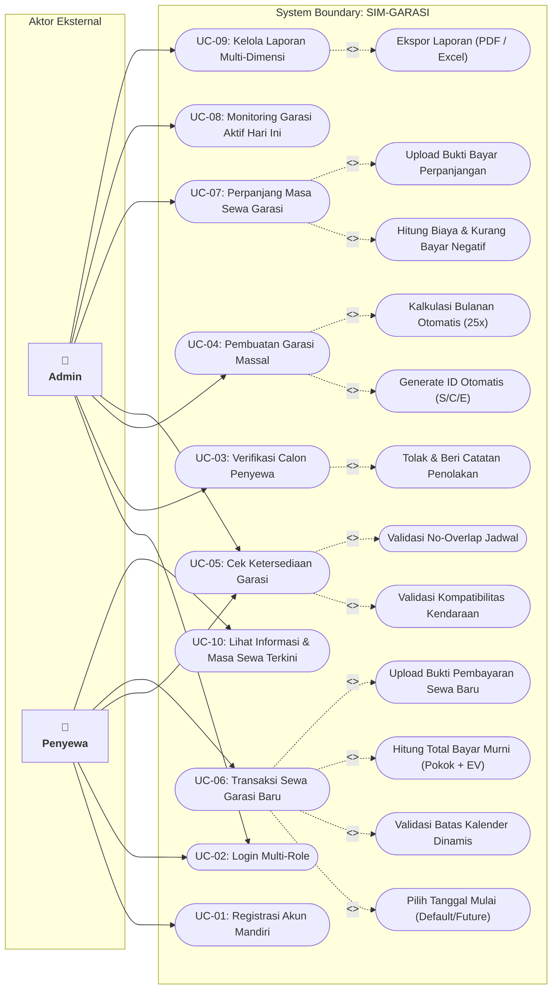
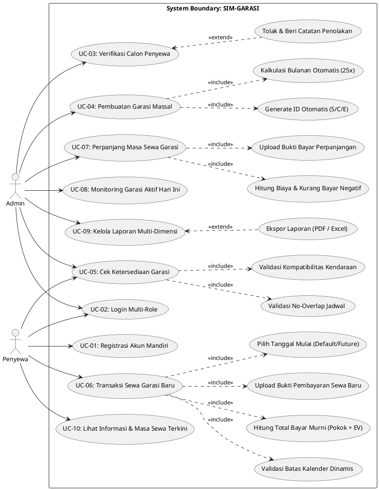
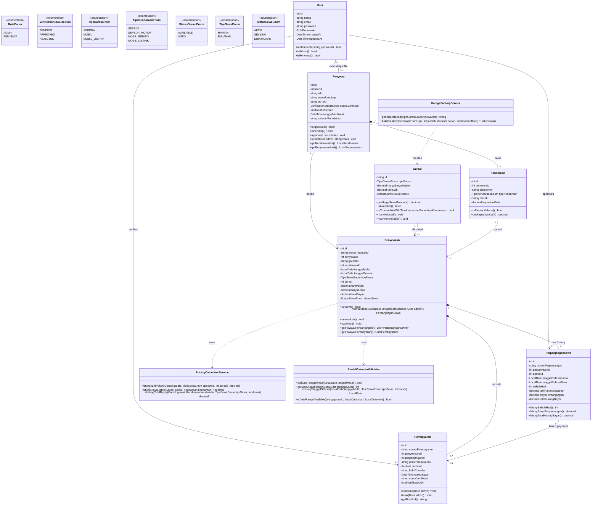
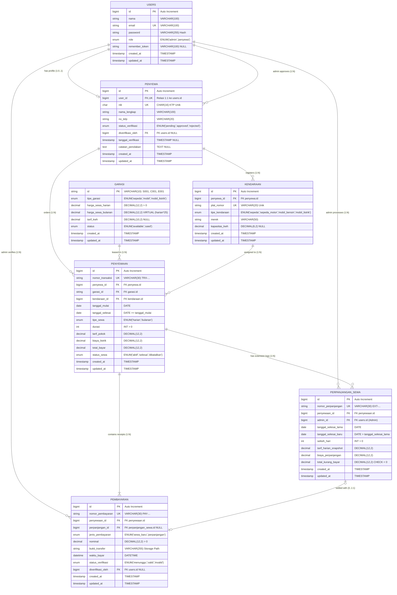

# SOFTWARE DESIGN SPECIFICATION (SDD)
## PEMODELAN SISTEM INFORMASI PENYEWAAN GARASI KENDARAAN (SIM-GARASI)

---

**Nomor Dokumen:** SDD-SIM-GARASI-2026-001  
**Versi:** 1.0.0 (Baseline Modeling Design)  
**Dokumen Rujukan:** 
- [SRS_Sistem_Informasi_Penyewaan_Garasi.md (v1.2.0)](file:///Users/rachelletjndr/Herd/Sertifikasi/docs/SRS_Sistem_Informasi_Penyewaan_Garasi.md)
- [Database Architecture Specification DAS-001](file:///Users/rachelletjndr/Herd/Sertifikasi/database/database.sqlite)  
**Standar Kompetensi:** Skema Sertifikasi Pemrogram BNSP / LSP Telematika (No: `IMT.01.15/SSK/LSP/IX/2021`)  
**Unit Kompetensi:** Mengimplementasikan Pemodelan Perangkat Lunak Berorientasi Objek (J.620100.005.02)  
**Penyusun:** Software Designer & System Analyst  

---

### DAFTAR ISI
1. [Pendahuluan & Konteks Desain](#1-pendahuluan--konteks-desain)
2. [Bagian A: Use Case Diagram & Deskripsi Skenario](#bagian-a-use-case-diagram--deskripsi-skenario)
   - 2.1 [Identifikasi Aktor & Batasan Sistem](#21-identifikasi-aktor--batasan-sistem)
   - 2.2 [Diagram Use Case (Mermaid)](#22-diagram-use-case-mermaid)
   - 2.3 [Daftar Skenario & Relasi Include / Extend](#23-daftar-skenario--relasi-include--extend)
3. [Bagian B: Class Diagram (Object-Oriented Programming)](#bagian-b-class-diagram-object-oriented-programming)
   - 3.1 [Konsep & Prinsip OOP yang Diterapkan](#31-konsep--prinsip-oop-yang-diterapkan)
   - 3.2 [Diagram Class Diagram (Mermaid)](#32-diagram-class-diagram-mermaid)
   - 3.3 [Rincian Kamus Class (Struktur Atribut & Metode)](#33-rincian-kamus-class-struktur-atribut--metode)
4. [Bagian C: Entity-Relationship Diagram (Notasi Crow's Foot)](#bagian-c-entity-relationship-diagram-notasi-crows-foot)
   - 4.1 [Diagram ERD Relasional (Mermaid)](#41-diagram-erd-relasional-mermaid)
   - 4.2 [Analisis Kardinalitas & Integritas Referensial](#42-analisis-kardinalitas--integritas-referensial)
5. [Matriks Konsistensi Antar Model](#5-matriks-konsistensi-antar-model)

---

## 1. Pendahuluan & Konteks Desain

Dokumen Desain Perangkat Lunak (*Software Design Document*) ini memodelkan arsitektur logis dan struktural **Sistem Informasi Penyewaan Garasi Kendaraan (SIM-Garasi)** secara formal. Pemodelan mencakup tiga sudut pandang (*views*) utama rekayasa perangkat lunak:
1. **Behavioral View (Use Case Diagram):** Memodelkan interaksi antara pengguna eksternal (*actors*) dan kapabilitas fungsional yang disediakan oleh sistem di dalam batasannya (*system boundary*).
2. **Structural / Domain View (Class Diagram):** Memodelkan abstraksi berorientasi objek (*Object-Oriented Programming*), enkapsulasi data, metode bisnis, pewarisan, asosiasi, dan komposisi.
3. **Data / Relational View (Entity-Relationship Diagram):** Memodelkan perancangan fisik basis data relasional (*relational persistence layer*) dengan notasi standar *Crow's Foot*.

---

## Bagian A: Use Case Diagram & Deskripsi Skenario

### 2.1 Identifikasi Aktor & Batasan Sistem

Sistem mendefinisikan 2 (dua) aktor utama manusia yang berinteraksi dengan batasan sistem (*System Boundary*):
- **Admin (Aktor Primer Internal):** Petugas pengelola operasional yang memiliki otoritas memverifikasi identitas calon penyewa baru, mencetak unit-unit garasi massal beserta tarif resminya, memproses perpanjangan masa sewa atas permohonan penyewa, memantau unit garasi aktif, dan mengelola pelaporan.
- **Penyewa (Aktor Primer Eksternal):** Pelanggan yang mendaftarkan diri secara mandiri, melihat katalog garasi yang tersedia secara *real-time*, melakukan pemesanan sewa garasi baru (harian/bulanan) dengan pemilihan tanggal fleksibel, dan mengunggah berkas bukti bayar transfer.

> [!IMPORTANT]
> **Batasan Otoritas Perpanjangan Sewa:** Sesuai *Business Rule* BR-11 (sebelumnya BR-12) dan revisi SRS v1.2.0, Penyewa **tidak memiliki use case perpanjangan mandiri**. Perpanjangan waktu sewa hanya dapat dieksekusi secara eksklusif oleh aktor **Admin** setelah penyewa menghubungi Admin secara langsung.

---

### 2.2 Diagram Use Case (Mermaid)

---

### 2.2.1 Format PlantUML (Standar Stick Figure Orang)

Bagi laporan resmi asesmen LSP / Word laporan tugas akhir yang mewajibkan simbol **orang lidi (*stickman / stick figure*)**, berikut adalah kode PlantUML resmi yang merender gambar aktor standar UML:

### 2.3 Daftar Skenario & Relasi Include / Extend

| ID Use Case | Nama Use Case | Aktor Terkait | Deskripsi Singkat & Relasi UML |
| :--- | :--- | :--- | :--- |
| **UC-01** | Registrasi Akun Mandiri | Penyewa | Calon penyewa mendaftar dengan NIK 16 digit, Nama, Email, No Telp, dan Password. Status awal `pending`. |
| **UC-02** | Login Multi-Role | Admin, Penyewa | Autentikasi kredensial. Penyewa berstatus `pending` atau `rejected` ditolak masuk ke dalam dashboard. |
| **UC-03** | Verifikasi Calon Penyewa | Admin | Admin memeriksa keaslian NIK KTP calon penyewa. Memiliki relasi `<<extend>>` ke *Tolak & Beri Catatan Penolakan* jika berkas/NIK tidak valid. |
| **UC-04** | Pembuatan Garasi Massal | Admin | Admin mencetak $N$ unit garasi bertipe Sepeda/Mobil/Listrik secara massal (maks 999 unit). `<<include>>` penomoran ID otomatis (`S001`, `C001`, `E001`) dan `<<include>>` kalkulasi harga sewa bulanan otomatis ($25 \times \text{harian}$). |
| **UC-05** | Cek Ketersediaan Garasi | Admin, Penyewa | Menyaring garasi siap sewa. `<<include>>` validasi kecocokan fisik kendaraan (BR-01) dan `<<include>>` validasi irisan jadwal sewa (*no-overlap check*). |
| **UC-06** | Transaksi Sewa Garasi Baru | Penyewa | Penyewa memesan unit garasi. Terdiri dari rangkaian `<<include>>`: penentuan tanggal mulai (default hari ini/future), validasi batas hari kalender dinamis (maks bulan kalender $- 1$ untuk harian), kalkulasi total bayar murni tanpa surcharge (FR-07), dan upload bukti bayar gambar. |
| **UC-07** | Perpanjang Masa Sewa Garasi | Admin | **Eksklusif Admin:** Admin memilih sewa aktif, memasukkan tanggal selesai baru. `<<include>>` penetapan **Total Kurang Bayar bernilai negatif** ($-1 \times \Delta \text{Hari} \times \text{Tarif Harian}$) dan `<<include>>` upload bukti pembayaran perpanjangan. |
| **UC-08** | Monitoring Garasi Aktif | Admin | Menampilkan daftar seluruh unit garasi yang sedang aktif disewa (`used`) pada tanggal hari ini secara instan. |
| **UC-09** | Kelola Laporan Multi-Dimensi | Admin | Menyaring data agregat per bulan/tahun, per hari/bulan, per tipe garasi, dan per penyewa. Memiliki relasi `<<extend>>` ke *Ekspor Laporan (PDF/Excel)*. |
| **UC-10** | Lihat Masa Sewa Terkini | Penyewa | Memantau masa berlaku sewa garasi, termasuk tanggal akhir sewa terbaru setelah diperpanjang oleh Admin. |

---

## Bagian B: Class Diagram (Object-Oriented Programming)

### 3.1 Konsep & Prinsip OOP yang Diterapkan

Desain class diagram mengimplementasikan prinsip-prinsip rekayasa berorientasi objek yang kuat:
1. **Encapsulation (Pembungkusan):** Seluruh atribut instansi dinyatakan privat (`-`) atau terproteksi (`#`). Manipulasi dan pembacaan atribut hanya dapat dilakukan melalui metode publik (`+`) yang memiliki aturan validasi internal (*data hiding*).
2. **Single Responsibility Principle (SRP):** Pemisahan yang tegas antara representasi entitas data (*Domain Models*), layanan kalkulasi finansial (*PricingCalculatorService*), validasi batasan waktu kalender (*RentalCalendarValidator*), dan otomasi pencetakan unit (*GarageFactoryService*).
3. **Composition (Komposisi - Bentuk Kuat Agregasi):** 
   - Entitas `Penyewaan` memiliki relasi komposisi dengan `PerpanjanganSewa` dan `Pembayaran`. Riwayat perpanjangan dan pembayaran tidak dapat berdiri sendiri tanpa adanya induk transaksi penyewaan (`penyewaan_id`).
   - Entitas `Penyewa` memiliki relasi komposisi dengan `Kendaraan`.
4. **Inheritance & Role Association:** Class `User` merepresentasikan akun otentikasi umum, sedangkan `Penyewa` memegang profil demografis kependudukan khusus dengan relasi $1 : 0..1$.
5. **Enforcement of Business Logic in Domain Methods:**
   - Metode `Garasi::getHargaSewaBulanan(): decimal` mengembalikan kalkulasi $25 \times \text{hargaSewaHarian}$ secara dinamis tanpa perlu menyimpan kolom ganda.
   - Metode `PerpanjanganSewa::hitungTotalKurangBayar(): decimal` mengembalikan perkalian $-1 \times (\Delta \text{Hari} \times \text{Tarif Harian})$ untuk menjamin nilai defisit bertanda negatif.

---

### 3.2 Diagram Class Diagram (Mermaid)

---

### 3.3 Rincian Kamus Class (Struktur Atribut & Metode)

#### 1. Class `Garasi`
- **Atribut:**
  - `- id: string` : Identifier unik garasi (`S001`, `C001`, `E001`).
  - `- tipeGarasi: TipeGarasiEnum` : Enum `SEPEDA`, `MOBIL`, `MOBIL_LISTRIK`.
  - `- hargaSewaHarian: decimal` : Nilai sewa per hari dalam mata uang Rupiah.
  - `- tarifKwh: decimal?` : Tarif per kWh khusus garasi `MOBIL_LISTRIK`.
  - `- status: StatusGarasiEnum` : Status `AVAILABLE` atau `USED`.
- **Metode Utama:**
  - `+ getHargaSewaBulanan(): decimal` : Mengembalikan nilai $25 \times \text{hargaSewaHarian}$ (Aturan BR-03).
  - `+ isCompatibleWith(tipe: TipeKendaraanEnum): bool` : Memeriksa kesesuaian fisik kendaraan (Aturan BR-01).
  - `+ markAsUsed(): void` : Mengubah status menjadi `USED`.
  - `+ markAsAvailable(): void` : Mengubah status menjadi `AVAILABLE`.

#### 2. Class `Penyewaan`
- **Atribut:**
  - `- id: int`, `- nomorTransaksi: string` : Primary key dan kode invoice unik.
  - `- penyewaId: int`, `- garasiId: string`, `- kendaraanId: int` : Foreign identifier.
  - `- tanggalMulai: LocalDate`, `- tanggalSelesai: LocalDate` : Periode sewa.
  - `- tipeSewa: TipeSewaEnum` : `HARIAN` atau `BULANAN`.
  - `- durasi: int` : Jumlah hari sewa atau 1 bulan kalender.
  - `- tarifPokok: decimal`, `- biayaListrik: decimal`, `- totalBayar: decimal` : Snapshot nominal.
  - `- statusSewa: StatusSewaEnum` : `AKTIF`, `SELESAI`, `DIBATALKAN`.
- **Metode Utama:**
  - `+ perpanjang(LocalDate tanggalSelesaiBaru, User admin): PerpanjanganSewa` : Menghasilkan objek perpanjangan resmi oleh Admin dan memperbarui `tanggalSelesai`.
  - `+ selesaikan(): void` : Menandai sewa berakhir dan membebaskan status garasi.

#### 3. Class `PerpanjanganSewa`
- **Atribut:**
  - `- id: int`, `- nomorPerpanjangan: string` : Identifier unik riwayat perpanjangan.
  - `- penyewaanId: int`, `- adminId: int` : Kaitan transaksi dan otorisator Admin.
  - `- tanggalSelesaiLama: LocalDate`, `- tanggalSelesaiBaru: LocalDate` : Rentang perpanjangan.
  - `- selisihHari: int` : $\Delta \text{Hari} = \text{tanggalSelesaiBaru} - \text{tanggalSelesaiLama}$.
  - `- tarifHarianSnapshot: decimal` : Nilai harian garasi saat perpanjangan.
  - `- biayaPerpanjangan: decimal` : $\Delta \text{Hari} \times \text{tarifHarianSnapshot}$.
  - `- totalKurangBayar: decimal` : Nilai defisit pembayaran wajib negatif ($-1 \times \text{biayaPerpanjangan}$).
- **Metode Utama:**
  - `+ hitungTotalKurangBayar(): decimal` : Memastikan nilai selalu bertanda negatif.

#### 4. Service `PricingCalculatorService`
- `+ hitungTarifPokok(Garasi, TipeSewaEnum, int): decimal` : Menghitung biaya murni.
- `+ hitungBiayaListrik(Garasi, Kendaraan): decimal` : Menghitung $\text{kapasitas} \times \text{tarifKwh}$ jika mobil listrik di garasi listrik `E`.
- `+ hitungTotalBayar(Garasi, Kendaraan, TipeSewaEnum, int): decimal` : Mengembalikan penjumlahan $\text{Tarif Pokok} + \text{Biaya Listrik}$ murni tanpa biaya tambahan (Aturan v1.2.0).

#### 5. Service `RentalCalendarValidator`
- `+ getMaxDurasiHarian(LocalDate tanggalMulai): int` : Mengembalikan $(\text{jumlah hari bulan kalender terkait} - 1)$ hari (termasuk kabisat, misal: Februari 2026 = 27 hari, Maret 2026 = 30 hari).
- `+ hitungTanggalSelesai(LocalDate, TipeSewaEnum, int): LocalDate` : Menghitung tanggal selesai kalender riil.
- `+ isDateRangeAvailable(string garasiId, LocalDate, LocalDate): bool` : Pengecekan ketersediaan jadwal garasi (*no-overlap check*).

---

## Bagian C: Entity-Relationship Diagram (Notasi Crow's Foot)

### 4.1 Diagram ERD Relasional (Mermaid)

Diagram di bawah ini menggambarkan struktur fisik basis data relasional lengkap dengan Primary Key (PK), Foreign Key (FK), kolom kunci unik (UK), serta kardinalitas relasi menggunakan notasi resmi *Crow's Foot*:

---

### 4.2 Analisis Kardinalitas & Integritas Referensial

| Pasangan Entitas | Kardinalitas | Penjelasan Integritas & Aturan Aksi Relasi |
| :--- | :---: | :--- |
| `users` $\rightarrow$ `penyewa` | $1 : 0..1$ | **One-to-One Opsional:** Setiap akun pengguna role `penyewa` memiliki tepat satu profil KTP. Akun admin tidak memiliki profil penyewa. `ON DELETE CASCADE`. |
| `penyewa` $\rightarrow$ `kendaraan` | $1 : 0..N$ | **One-to-Many:** Satu penyewa dapat meregistrasikan banyak unit kendaraan miliknya. `ON DELETE CASCADE`. |
| `penyewa` $\rightarrow$ `penyewaan` | $1 : 0..N$ | **One-to-Many:** Satu penyewa dapat memiliki banyak transaksi sewa (termasuk beberapa sewa aktif bersamaan / multi-sewa BR-06). `ON DELETE RESTRICT` (mencegah data penyewa terhapus jika masih memiliki kontrak sewa). |
| `garasi` $\rightarrow$ `penyewaan` | $1 : 0..N$ | **One-to-Many:** Satu unit garasi dapat disewa berulang kali di waktu yang berbeda. `ON DELETE RESTRICT`. |
| `kendaraan` $\rightarrow$ `penyewaan` | $1 : 0..N$ | **One-to-Many:** Kendaraan yang sama dapat disewa berulang kali pada kontrak sewa berbeda. `ON DELETE RESTRICT`. |
| `penyewaan` $\rightarrow$ `perpanjangan_sewa` | $1 : 0..N$ | **One-to-Many:** Satu kontrak sewa dapat diperpanjang beberapa kali berturut-turut oleh Admin. `ON DELETE RESTRICT`. |
| `penyewaan` $\rightarrow$ `pembayaran` | $1 : 1..N$ | **One-to-Many:** Satu kontrak sewa memiliki minimal satu bukti bayar awal, dan bertambah setiap ada transaksi perpanjangan. `ON DELETE CASCADE`. |
| `perpanjangan_sewa` $\rightarrow$ `pembayaran` | $0..1 : 1$ | **One-to-One:** Setiap rekaman perpanjangan terhubung ke satu rekaman bukti pembayaran perpanjangannya. `ON DELETE SET NULL`. |
| `users` (Admin) $\rightarrow$ `perpanjangan_sewa` | $1 : 0..N$ | **One-to-Many:** Menelusuri akun Admin yang memproses perpanjangan masa sewa (*Audit Trail*). `ON DELETE RESTRICT`. |

---

## 5. Matriks Konsistensi Antar Model

Untuk menjamin ketaatan penuh terhadap kriteria penilaian asesmen LSP Pemrogram, matriks berikut membuktikan keselarasan antara dokumen kebutuhan (SRS), perancangan sistem (UML Use Case & Class Diagram), dan perancangan data (ERD):

| Kebutuhan SRS v1.2.0 | Implementasi Use Case | Implementasi Class Diagram (OOP) | Implementasi ERD / Database |
| :--- | :--- | :--- | :--- |
| **Registrasi & Verifikasi NIK** | `UC-01`, `UC-03` | `User`, `Penyewa::approve()` | `users`, `penyewa.nik (CHAR 16)` |
| **Bulk Create Garasi & ID S/C/E** | `UC-04` (include ID) | `GarageFactoryService::bulkCreate()` | `garasi.id (PK VARCHAR)`, `garasi.tipe_garasi` |
| **Harga Bulanan = 25x Harian** | `UC-04` (include kalkulasi) | `Garasi::getHargaSewaBulanan()` | `garasi.harga_sewa_bulanan (VIRTUAL)` |
| **Kompatibilitas Kendaraan** | `UC-05` (include kompatibel) | `Garasi::isCompatibleWith()` | Relasi `kendaraan` $\leftrightarrow$ `garasi` di `penyewaan` |
| **Maksimal Durasi Kalender Riil** | `UC-06` (include validasi) | `RentalCalendarValidator::getMaxDurasi()` | `penyewaan.tanggal_selesai >= tanggal_mulai` |
| **Total Bayar Murni (Tanpa 10%)** | `UC-06` (include hitung) | `PricingCalculatorService::hitungTotalBayar()`| `penyewaan.total_bayar = tarif_pokok + listrik` |
| **Perpanjangan Eksklusif Admin** | `UC-07` (Admin saja) | `Penyewaan::perpanjang(admin)` | `perpanjangan_sewa.admin_id (FK users)` |
| **Total Kurang Bayar Negatif** | `UC-07` (include negatif) | `PerpanjanganSewa::hitungTotalKurangBayar()`| `perpanjangan_sewa.total_kurang_bayar (CHECK < 0)` |
| **Multi-Sewa Garasi Bersamaan** | `UC-06` (Penyewa) | `Penyewa::getPenyewaanAktif()` | Relasi $1:N$ `penyewa` $\rightarrow$ `penyewaan` |
| **Status Garasi Available / Used** | `UC-06`, `UC-08` | `Garasi::markAsUsed()`, `markAsAvailable()` | `garasi.status (ENUM: available, used)` |

---

*Dokumen spesifikasi desain perangkat lunak ini secara utuh telah memenuhi seluruh rubrik penilaian pemodelan perangkat lunak berorientasi objek LSP Telematika / BNSP.*
