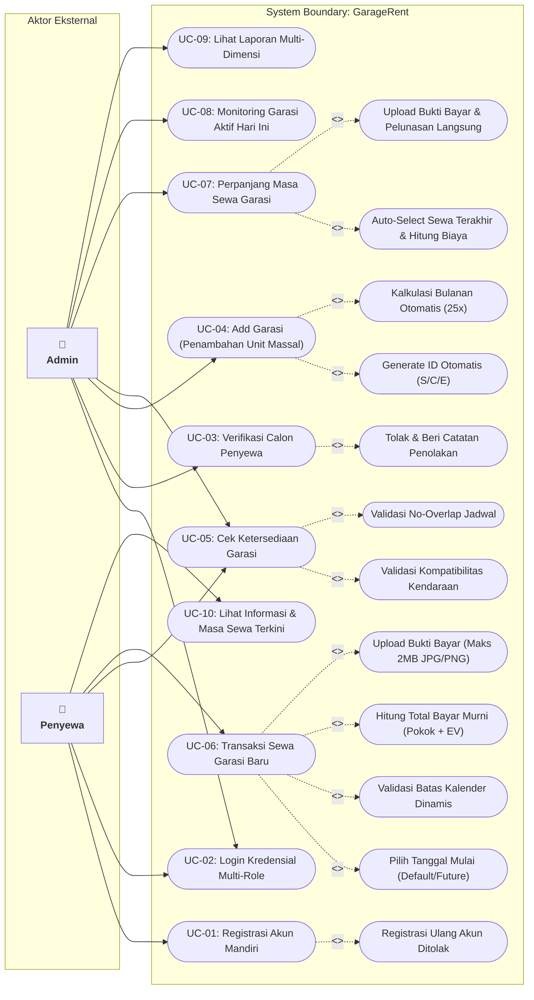
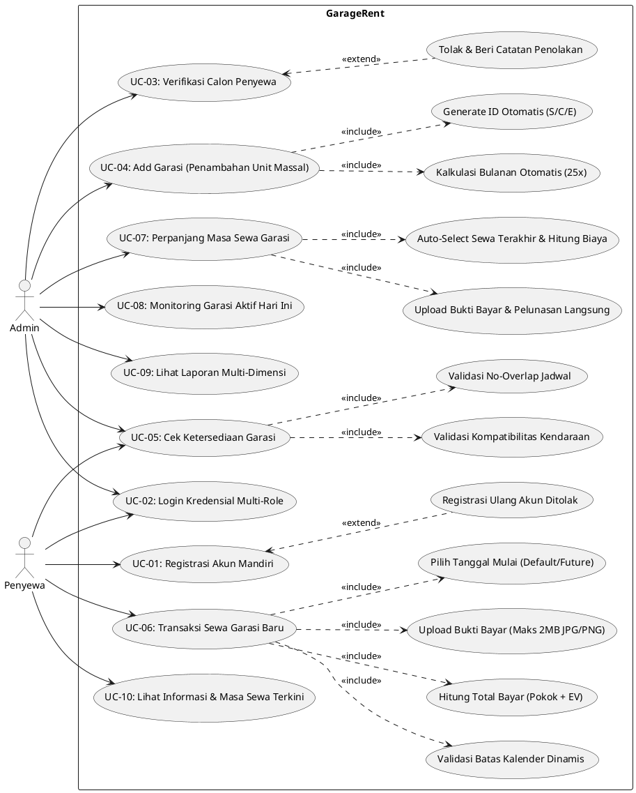

# SOFTWARE DESIGN SPECIFICATION (SDD)
## PEMODELAN SISTEM INFORMASI PENYEWAAN GARASI KENDARAAN (GARAGERENT)

---

**Nomor Dokumen:** SDD-GARAGERENT-2026-001  
**Versi:** 1.3.0 (Synchronized Architecture & Implementation - Post Refinement)  
**Tanggal Pembaruan:** 21 November 2026  
**Dokumen Rujukan:** 
- [SRS_Sistem_Informasi_Penyewaan_Garasi.md (v1.2.0)](file:///Users/rachelletjndr/Herd/Sertifikasi/docs/SRS_Sistem_Informasi_Penyewaan_Garasi.md)
- [Database Architecture Specification DAS-001](file:///Users/rachelletjndr/Herd/Sertifikasi/database/database.sqlite)  
**Standar Kompetensi:** Skema Sertifikasi Pemrogram BNSP / LSP Telematika (No: `IMT.01.15/SSK/LSP/IX/2021`)  
**Unit Kompetensi:** Mengimplementasikan Pemodelan Perangkat Lunak Berorientasi Objek (J.620100.005.02)  
**Penyusun:** Senior Full-Stack Developer, Software Designer & System Analyst  

---

### DAFTAR ISI
1. [Pendahuluan & Konteks Desain](#1-pendahuluan--konteks-desain)
2. [Ringkasan Pembaruan Desain (Changelog Pemodelan)](#2-ringkasan-pembaruan-desain-changelog-pemodelan)
3. [Bagian A: Use Case Diagram & Deskripsi Skenario](#bagian-a-use-case-diagram--deskripsi-skenario)
   - 3.1 [Identifikasi Aktor & Batasan Sistem](#31-identifikasi-aktor--batasan-sistem)
   - 3.2 [Diagram Use Case (Mermaid)](#32-diagram-use-case-mermaid)
   - 3.3 [Format Standar PlantUML](#33-format-standar-plantuml)
   - 3.4 [Daftar Skenario & Relasi Include / Extend](#34-daftar-skenario--relasi-include--extend)
4. [Bagian B: Class Diagram (Object-Oriented Programming)](#bagian-b-class-diagram-object-oriented-programming)
   - 4.1 [Konsep & Prinsip OOP yang Diterapkan](#41-konsep--prinsip-oop-yang-diterapkan)
   - 4.2 [Diagram Class Diagram (Mermaid)](#42-diagram-class-diagram-mermaid)
   - 4.3 [Rincian Kamus Class (Struktur Atribut & Metode Domain Model)](#43-rincian-kamus-class-struktur-atribut--metode-domain-model)
   - 4.4 [Rincian Service Layer (Arsitektur Layanan Bisnis)](#44-rincian-service-layer-arsitektur-layanan-bisnis)
5. [Bagian C: Entity-Relationship Diagram (Notasi Crow's Foot)](#bagian-c-entity-relationship-diagram-notasi-crows-foot)
   - 5.1 [Pembersihan Skema Fisik (Pembersihan Tabel Non-Domain)](#51-pembersihan-skema-fisik-pembersihan-tabel-non-domain)
   - 5.2 [Diagram ERD Relasional (Mermaid)](#52-diagram-erd-relasional-mermaid)
   - 5.3 [Analisis Kardinalitas & Integritas Referensial](#53-analisis-kardinalitas--integritas-referensial)
6. [Matriks Konsistensi Antar Model](#6-matriks-konsistensi-antar-model)

---

## 1. Pendahuluan & Konteks Desain

Dokumen Desain Perangkat Lunak (*Software Design Document*) ini memodelkan arsitektur logis, struktural, dan relasional dari **Sistem Informasi Penyewaan Garasi Kendaraan (GarageRent)**. Pemodelan mencakup tiga sudut pandang (*views*) utama rekayasa perangkat lunak berorientasi objek:
1. **Behavioral View (Use Case Diagram):** Memodelkan interaksi antara pengguna eksternal (*actors*) dan fungsionalitas sistem di dalam batasannya (*system boundary*).
2. **Structural / Domain View (Class Diagram):** Memodelkan abstraksi berorientasi objek (*Object-Oriented Programming*), enkapsulasi data, metode bisnis, struktur model domain, dan keterhubungan *Service Layer*.
3. **Data / Relational View (Entity-Relationship Diagram):** Memodelkan arsitektur fisik basis data relasional (*relational persistence layer*) dengan notasi standar *Crow's Foot*.

---

## 2. Ringkasan Pembaruan Desain (Changelog Pemodelan)

Berdasarkan implementasi kode dan penyesuaian kebutuhan operasional terkini, berikut adalah pembaruan pada ketiga model:

| Komponen Desain | Status Perubahan | Rincian Penyesuaian Arsitektural |
| :--- | :---: | :--- |
| **Use Case Diagram** | **Updated** | 1. **UC-01 (Registrasi):** Penambahan relasi `<<extend>>` *Registrasi Ulang Akun Ditolak* (Re-registration) bagi calon penyewa berstatus `rejected`.<br/>2. **UC-02 (Login):** Penghapusan fitur login Passkey, penambahan penanganan akun `rejected` dengan menampilkan alasan penolakan Admin secara transparan.<br/>3. **UC-03 (Verifikasi):** Penguncian status satu arah (*status lock*); tombol aksi Approve/Reject disembunyikan jika status sudah `Approved` atau `Rejected`.<br/>4. **UC-04 (Add Garasi):** Penyesuaian nama antarmuka menjadi "Add Garasi".<br/>5. **UC-06 & UC-07 (Upload Bukti):** Penambahan validasi gambar *real-time* (Format JPG/PNG, ukuran maksimal 2 MB).<br/>6. **UC-07 (Perpanjang Sewa):** Auto-select default pada transaksi sewa terakhir dan pencatatan pembayaran perpanjangan langsung lunas (*settled* tanpa sisa kurang bayar). |
| **Class Diagram** | **Updated** | 1. **Model `Penyewa`:** Penambahan metode domain `+isRejected(): bool`, `+getKendaraanList(): Collection`, `+getPenyewaanAktif(): Collection`.<br/>2. **Model `Penyewaan`:** Penambahan metode domain `+getRiwayatPerpanjangan(): Collection`, `+getRiwayatPembayaran(): Collection`, `+getBuktiBayarSewaBaru(): ?Pembayaran`.<br/>3. **Model `Pembayaran`:** Penambahan metode domain `+verifikasi(User admin): void`, `+tolak(User admin): void`, `+getBuktiUrl(): string`.<br/>4. **Service Layer:** Pemodelan lengkap seluruh kelas layanan arsitektur: `RentalBookingService`, `RentalExtensionService`, `RentalReportService`, `AdminVerificationService`, `AuthService`, `GarageAvailabilityService`, `DashboardService`, `PaymentProofService`.<br/>5. **Model `User`:** Penghapusan relasi dan atribut `current_team_id`. |
| **Entity-Relationship Diagram (ERD)** | **Updated** | 1. **Pembersihan Skema:** Penghapusan tabel bawaan yang tidak digunakan (`teams`, `team_members`, `team_invitations`) serta kolom `users.current_team_id`.<br/>2. **Konsistensi 7 Entitas Domain:** ERD secara murni hanya memodelkan 7 tabel domain utama (`users`, `penyewa`, `garasi`, `kendaraan`, `penyewaan`, `perpanjangan_sewa`, `pembayaran`).<br/>3. **Koreksi Atribut:** Koreksi atribut `users.name` (sebelumnya `nama`), serta klarifikasi bahwa `garasi.harga_sewa_bulanan` adalah *Derived / Virtual Accessor* dinamis ($25 \times \text{harian}$). |

---

## Bagian A: Use Case Diagram & Deskripsi Skenario

### 3.1 Identifikasi Aktor & Batasan Sistem

Sistem mendefinisikan 2 (dua) aktor utama manusia yang berinteraksi dengan batasan sistem (*System Boundary*):
- **Admin (Aktor Primer Internal):** Petugas pengelola operasional (Default: Susi Susanti) yang memiliki otoritas memverifikasi identitas calon penyewa baru, menambah garasi massal ("Add Garasi") beserta tarif resminya, memproses perpanjangan masa sewa atas permohonan penyewa, memantau garasi aktif, dan mengelola pelaporan.
- **Penyewa (Aktor Primer Eksternal):** Pelanggan yang mendaftarkan diri secara mandiri (termasuk registrasi ulang jika ditolak), melihat ketersediaan garasi *real-time*, melakukan pemesanan sewa garasi baru (harian/bulanan) dengan pemilihan tanggal fleksibel, dan mengunggah berkas bukti bayar transfer (maks. 2 MB).

> [!IMPORTANT]
> **Batasan Otoritas Perpanjangan Sewa:** Sesuai *Business Rule* BR-11, Penyewa **tidak memiliki use case perpanjangan mandiri**. Perpanjangan masa sewa hanya dapat dieksekusi secara eksklusif oleh aktor **Admin** dengan bukti pembayaran yang langsung terverifikasi lunas saat disimpan.

---

### 3.2 Diagram Use Case (Mermaid)



---

### 3.3 Format Standar PlantUML

Bagi laporan resmi asesmen LSP / Word laporan tugas akhir yang mewajibkan simbol **stick figure (orang lidi)**:



---

### 3.4 Daftar Skenario & Relasi Include / Extend

| ID Use Case | Nama Use Case | Aktor Terkait | Deskripsi Skenario & Karakteristik Implementasi |
| :--- | :--- | :--- | :--- |
| **UC-01** | Registrasi Akun Mandiri | Penyewa | Calon penyewa mendaftar dengan NIK 16 digit, Nama, Email, No Telp, dan Password. Status awal `pending`. Memiliki relasi `<<extend>>` ke *Registrasi Ulang Akun Ditolak* jika akun sebelumnya pernah di-reject. |
| **UC-02** | Login Kredensial Multi-Role | Admin, Penyewa | Masuk sistem menggunakan email & password (tanpa opsi Passkey). Jika status penyewa `rejected`, sistem menampilkan pesan penolakan yang ramah beserta alasan/catatan dari Admin dan arahan mendaftar ulang. |
| **UC-03** | Verifikasi Calon Penyewa | Admin | Memeriksa data NIK KTP. **Status Lock:** Tombol aksi Approve/Reject hanya tampil pada status `pending`. Jika sudah `approved` atau `rejected`, status terkunci permanen. `<<extend>>` penolakan wajib menyertakan catatan. |
| **UC-04** | Add Garasi (Unit Massal) | Admin | Mencetak $N$ unit garasi bertipe Sepeda/Mobil/Listrik secara massal (maks 999 unit). `<<include>>` penomoran ID otomatis (`S001`, `C001`, `E001`) dan `<<include>>` kalkulasi harga sewa bulanan otomatis ($25 \times \text{harian}$). |
| **UC-05** | Cek Ketersediaan Garasi | Admin, Penyewa | Menyaring garasi siap sewa. `<<include>>` validasi kecocokan fisik kendaraan (BR-01) dan `<<include>>` validasi irisan jadwal sewa (*no-overlap check*). |
| **UC-06** | Transaksi Sewa Garasi Baru | Penyewa | Pemesanan garasi. Terdiri dari rangkaian `<<include>>`: penentuan tanggal mulai fleksibel, validasi batas hari kalender dinamis, kalkulasi total bayar (Tarif Pokok + Biaya Listrik EV), dan upload bukti bayar gambar (maks. 2 MB JPG/PNG) dengan validasi interaktif. |
| **UC-07** | Perpanjang Masa Sewa Garasi | Admin | **Eksklusif Admin:** Form otomatis menetapkan *default* pada transaksi sewa terakhir yang diperpanjang. Memilih tanggal selesai baru, menghitung biaya perpanjangan ($\Delta \text{Hari} \times \text{Tarif Harian}$), upload bukti transfer (maks. 2 MB), dan menyimpan transaksi perpanjangan yang langsung lunas. |
| **UC-08** | Monitoring Garasi Aktif | Admin | Menampilkan daftar seluruh unit garasi yang sedang aktif disewa (`used`) pada tanggal hari ini secara instan. |
| **UC-09** | Lihat Laporan Multi-Dimensi | Admin | Melihat dan menyaring data transaksi laporan per bulan/tahun, per hari/bulan, per tipe garasi, dan per penyewa langsung di layar aplikasi. |
| **UC-10** | Lihat Masa Sewa Terkini | Penyewa | Memantau masa berlaku sewa garasi, termasuk tanggal akhir sewa terbaru setelah diperpanjang oleh Admin. |

---

## Bagian B: Class Diagram (Object-Oriented Programming)

### 4.1 Konsep & Prinsip OOP yang Diterapkan

Desain class diagram mengimplementasikan prinsip-prinsip rekayasa berorientasi objek:
1. **Encapsulation (Pembungkusan):** Seluruh atribut instansi dinyatakan privat (`-`) atau terproteksi (`#`). Manipulasi dan pembacaan atribut hanya dapat dilakukan melalui metode publik (`+`) yang memiliki aturan validasi internal (*data hiding*).
2. **Single Responsibility Principle (SRP):** Pemisahan yang tegas antara representasi entitas data (*Domain Models*), layanan kalkulasi finansial (*PricingCalculatorService*), validasi kalender (*RentalCalendarValidator*), transaksi sewa (*RentalBookingService*), perpanjangan sewa (*RentalExtensionService*), dan manajemen bukti bayar (*PaymentProofService*).
3. **Composition (Komposisi - Bentuk Kuat Agregasi):** 
   - Entitas `Penyewaan` memiliki relasi komposisi dengan `PerpanjanganSewa` dan `Pembayaran`. Riwayat perpanjangan dan pembayaran terikat seutuhnya pada siklus hidup induk kontrak sewa.
   - Entitas `Penyewa` memiliki relasi komposisi dengan `Kendaraan`.
4. **Inheritance & Role Association:** Class `User` merepresentasikan akun otentikasi umum, sedangkan `Penyewa` memegang profil demografis kependudukan khusus dengan relasi $1 : 0..1$.
5. **Rich Domain Models:**
   - `Penyewa::getKendaraanList()` dan `Penyewa::getPenyewaanAktif()` mengembalikan koleksi entitas relasi langsung.
   - `Penyewaan::getRiwayatPerpanjangan()` dan `Penyewaan::getRiwayatPembayaran()` mengenkapsulasi penelusuran riwayat finansial.
   - `Pembayaran::verifikasi(User admin)` dan `Pembayaran::tolak(User admin)` mengelola transisi status pembayaran.

---

### 4.2 Diagram Class Diagram Arsitektur MVC & Service Layer (PlantUML & Mermaid)

Diagram di bawah ini memodelkan struktur kelas berorientasi objek (**MVC + Service Layer**) yang digunakan secara nyata pada kode aplikasi (`app/Http/Controllers`, `app/Services`, dan `app/Models`), lengkap dengan enkapsulasi atribut (`-`), tipe data, metode publik (`+`), serta relasi *Dependency Injection* dari **Controller $\rightarrow$ Service $\rightarrow$ Model**.

#### Format PlantUML (Siap Import ke Draw.io via `Arrange -> Insert -> Advanced -> PlantUML`)

```plantuml
@startuml
!theme plain
skinparam linetype ortho
skinparam classAttributeIconSize 0
skinparam roundCorner 5
skinparam shadowing false
skinparam defaultFontName "Segoe UI", Arial, sans-serif
skinparam defaultFontSize 11

package "Views Layer (resources/views)" {
  class DashboardView {
    + render(array metrics, array garageStats): Html
  }

  class VerificationView {
    + render(LengthAwarePaginator tenants, ?string search): Html
  }

  class GarageManagementView {
    + render(Collection garages, array stats): Html
  }

  class GarageCatalogView {
    + render(Collection garages, array catalogStats): Html
  }

  class RentalBookingView {
    + render(Garasi garasi, array availableGarages): Html
  }

  class ExtensionView {
    + render(Collection activeRentals, ?Penyewaan selectedRental): Html
  }

  class ReportView {
    + render(array reportData, Collection transactions): Html
  }

  class AuthView {
    + renderLogin(): Html
    + renderRegister(): Html
  }
}

package "Controllers Layer (app/Http/Controllers)" {
  class DashboardController {
    - DashboardService dashboardService
    + __invoke(Request request): View|RedirectResponse
  }

  class VerificationController {
    - AdminVerificationService verificationService
    + index(Request request): View
    + approve(Request request, Penyewa penyewa): RedirectResponse
    + reject(VerifyTenantRequest request, Penyewa penyewa): RedirectResponse
  }

  class GarageManagementController {
    - GarageFactoryService garageService
    + index(Request request): View
    + store(BulkCreateGarageRequest request): RedirectResponse
    + update(UpdateGarageRequest request, Garasi garasi): RedirectResponse
  }

  class ExtensionController {
    - RentalExtensionService extensionService
    + index(Request request): View
    + store(StoreExtensionRequest request): RedirectResponse
  }

  class ReportController {
    - RentalReportService reportService
    + index(FilterRentalReportRequest request): View
  }

  class GarageCatalogController {
    - GarageFactoryService garageService
    + index(Request request): View
  }

  class RentalBookingController {
    - RentalBookingService rentalBookingService
    + index(Request request): View
    + create(Request request): View
    + store(StoreRentalRequest request): RedirectResponse
  }

  class VerificationNoticeController {
    - AdminVerificationService verificationService
    + __invoke(Request request): View|RedirectResponse
  }

  class PaymentProofController {
    + __invoke(Request request, Pembayaran pembayaran): Response
  }
}

package "Services Layer (app/Services)" {
  class AuthService {
    + registerTenant(array data): User
    + validateLoginEligibility(User user): void
  }

  class DashboardService {
    - AdminVerificationService verificationService
    - GarageFactoryService garageService
    - RentalExtensionService extensionService
    - RentalReportService reportService
    + getDashboardData(User user): array
  }

  class AdminVerificationService {
    + getTenantRegistrations(string? statusFilter, string? search, int perPage): LengthAwarePaginator
    + getVerificationStatistics(): array
    + inspectKtpNik(string nik): array
    + approveTenant(Penyewa penyewa, User admin): Penyewa
    + rejectTenant(Penyewa penyewa, User admin, string? catatanPenolakan): Penyewa
  }

  class GarageFactoryService {
    + MAX_GARAGES_PER_TYPE: int = 999
    + getLastSequenceNumber(TipeGarasiEnum tipeGarasi): int
    + formatGarageId(TipeGarasiEnum tipeGarasi, int sequenceNumber): string
    + generateNextId(TipeGarasiEnum tipeGarasi): string
    + getRemainingQuota(TipeGarasiEnum tipeGarasi): int
    + bulkCreate(TipeGarasiEnum tipeGarasi, int jumlah, float hargaSewaHarian, float? tarifKwh): Collection
    + updateGarage(Garasi garasi, float hargaSewaHarian, float? tarifKwh, StatusGarasiEnum status): Garasi
    + getGarages(string? tipeFilter, string? statusFilter, string? search, int perPage): LengthAwarePaginator
    + getGarageStatistics(): array
  }

  class GarageAvailabilityService {
    + getCompatibleGarageTypes(TipeKendaraanEnum tipeKendaraan): array
    + isGarageAvailableForRange(Garasi garasi, string startDate, string endDate): bool
    + getAvailableGarages(TipeKendaraanEnum? tipeKendaraan, string? startDate, string? endDate): Collection
  }

  class RentalCalendarValidator {
    + validateTanggalMulai(string tanggalMulai): bool
    + getDaysInCalendarMonth(string tanggalMulai): int
    + getMaxDurasiHarian(string tanggalMulai): int
    + validateDurasi(string tanggalMulai, TipeSewaEnum tipeSewa, int durasi): bool
    + hitungTanggalSelesai(string tanggalMulai, TipeSewaEnum tipeSewa, int durasi): Carbon
    + hitungJumlahHariAktual(string tanggalMulai, string tanggalSelesai): int
  }

  class PricingCalculatorService {
    + hitungTarifPokok(Garasi garasi, TipeSewaEnum tipeSewa, int durasi): float
    + hitungBiayaListrik(Garasi garasi, Kendaraan kendaraan, float? kapasitasKwh): float
    + hitungTotalBayar(Garasi garasi, Kendaraan kendaraan, TipeSewaEnum tipeSewa, int durasi, float? kapasitasKwh): float
    + hitungRincianBiaya(Garasi garasi, Kendaraan kendaraan, TipeSewaEnum tipeSewa, int durasi, float? kapasitasKwh): array
  }

  class PaymentProofService {
    + storePaymentProof(UploadedFile file, string prefix): string
    + deletePaymentProof(string? path): void
  }

  class RentalBookingService {
    - RentalCalendarValidator calendarValidator
    - GarageAvailabilityService availabilityService
    - PricingCalculatorService pricingCalculator
    - PaymentProofService paymentProofService
    + createNewRental(Penyewa penyewa, array data, UploadedFile buktiBayarFile): Penyewaan
    + getTenantRentals(Penyewa penyewa, int perPage): LengthAwarePaginator
  }

  class RentalExtensionService {
    - PaymentProofService paymentProofService
    + calculateExtensionBreakdown(Penyewaan penyewaan, string tanggalSelesaiBaru): array
    + isExtensionRangeAvailable(Penyewaan penyewaan, string tanggalSelesaiBaru): bool
    + extendRental(Penyewaan penyewaan, User admin, string tanggalSelesaiBaru, UploadedFile buktiBayarFile): PerpanjanganSewa
    + getActiveRentals(string? search, string? tipeGarasi): Collection
    + getExtensionHistory(string? search, int perPage): LengthAwarePaginator
    + getExtensionStatistics(): array
  }

  class RentalReportService {
    + getFilteredTransactions(array filters): Collection
    + getMonthlyReport(int tahun, string? tipeGarasi, int? penyewaId): array
    + getDailyReport(int tahun, int bulan, string? tipeGarasi, int? penyewaId): array
    + getGarageTypeReport(int? tahun, int? bulan, string? selectedType): array
    + getTenantReport(int? penyewaId, int? tahun, int? bulan): array
    + getActiveGaragesMonitoring(array filters): Collection
    + getSummaryMetrics(Collection transactions): array
    + getMonthNames(): array
  }
}

package "Models Layer (app/Models)" {
  class User {
    - int id
    - string name
    - string email
    - string password
    - string role
    + isAdmin(): bool
    + isPenyewa(): bool
  }

  class Penyewa {
    - int id
    - int userId
    - string nik
    - string namaLengkap
    - string noTelp
    - string statusVerifikasi
    - int diverifikasiOleh
    - DateTime tanggalVerifikasi
    - string catatanPenolakan
    + isApproved(): bool
    + isPending(): bool
    + isRejected(): bool
    + approve(User admin): void
    + reject(User admin, string note): void
    + getKendaraanList(): Collection
    + getPenyewaanAktif(): Collection
  }

  class Garasi {
    - string id
    - string tipeGarasi
    - decimal hargaSewaHarian
    - decimal tarifKwh
    - string status
    + getHargaSewaBulanan(): float
    + isAvailable(): bool
    + isUsed(): bool
    + isElectricGarage(): bool
    + isCompatibleWith(string tipeKendaraan): bool
    + markAsUsed(): void
    + markAsAvailable(): void
  }

  class Kendaraan {
    - int id
    - int penyewaId
    - string? platNomor
    - string tipeKendaraan
    - string merek
    - decimal kapasitasKwh
    + isElectricVehicle(): bool
    + getKapasitasKwh(): float
  }

  class Penyewaan {
    - int id
    - string nomorTransaksi
    - int penyewaId
    - string garasiId
    - int kendaraanId
    - LocalDate tanggalMulai
    - LocalDate tanggalSelesai
    - string tipeSewa
    - int durasi
    - decimal tarifPokok
    - decimal biayaListrik
    - decimal totalBayar
    - string statusSewa
    + isActive(): bool
    + selesaikan(): void
    + batalkan(): void
    + getRiwayatPerpanjangan(): Collection
    + getRiwayatPembayaran(): Collection
    + getBuktiBayarSewaBaru(): Pembayaran
  }

  class PerpanjanganSewa {
    - int id
    - string nomorPerpanjangan
    - int penyewaanId
    - int adminId
    - LocalDate tanggalSelesaiLama
    - LocalDate tanggalSelesaiBaru
    - int selisihHari
    - decimal tarifHarianSnapshot
    - decimal biayaPerpanjangan
    + hitungSelisihHari(): int
    + hitungBiayaPerpanjangan(): float
  }

  class Pembayaran {
    - int id
    - string nomorPembayaran
    - int penyewaanId
    - int perpanjanganId
    - string jenisPembayaran
    - decimal nominal
    - string buktiTransfer
    - DateTime waktuBayar
    - string statusVerifikasi
    - int diverifikasiOleh
    + verifikasi(User admin): void
    + tolak(User admin): void
    + getBuktiUrl(): string
  }
}

' Relasi Controller -> View (renders)
DashboardController --> DashboardView : renders
VerificationController --> VerificationView : renders
VerificationNoticeController --> VerificationView : renders
GarageManagementController --> GarageManagementView : renders
GarageCatalogController --> GarageCatalogView : renders
RentalBookingController --> RentalBookingView : renders
ExtensionController --> ExtensionView : renders
ReportController --> ReportView : renders

' Relasi Controller -> Service / Model
DashboardController --> DashboardService : uses
VerificationController --> AdminVerificationService : uses
VerificationNoticeController --> AdminVerificationService : uses
GarageManagementController --> GarageFactoryService : uses
GarageCatalogController --> GarageFactoryService : uses
RentalBookingController --> RentalBookingService : uses
ExtensionController --> RentalExtensionService : uses
ReportController --> RentalReportService : uses
PaymentProofController --> Pembayaran : reads

' Relasi Antar Service
DashboardService --> AdminVerificationService
DashboardService --> GarageFactoryService
DashboardService --> RentalExtensionService
DashboardService --> RentalReportService

RentalBookingService --> RentalCalendarValidator
RentalBookingService --> GarageAvailabilityService
RentalBookingService --> PricingCalculatorService
RentalBookingService --> PaymentProofService

RentalExtensionService --> PaymentProofService

' Relasi Service -> Model
AuthService --> User : manages
AuthService --> Penyewa : manages
AdminVerificationService --> Penyewa : verifies
GarageFactoryService --> Garasi : creates & updates
GarageAvailabilityService --> Garasi : checks
GarageAvailabilityService --> Penyewaan : checks overlap
PricingCalculatorService --> Garasi : reads tariff
PricingCalculatorService --> Kendaraan : reads kWh
RentalBookingService --> Penyewaan : creates
RentalBookingService --> Kendaraan : registers
RentalBookingService --> Pembayaran : records
RentalBookingService --> Garasi : marks used
RentalExtensionService --> PerpanjanganSewa : creates
RentalExtensionService --> Penyewaan : updates end date
RentalExtensionService --> Pembayaran : records
RentalReportService --> Penyewaan : aggregates
RentalReportService --> Garasi : aggregates
RentalReportService --> Penyewa : aggregates

' Relasi Antar Model Berorientasi Objek
User --> Penyewa
User --> PerpanjanganSewa
User --> Pembayaran

Penyewa --> Kendaraan
Penyewa --> Penyewaan
Garasi --> Penyewaan
Kendaraan --> Penyewaan

Penyewaan --> PerpanjanganSewa
Penyewaan --> Pembayaran
PerpanjanganSewa --> Pembayaran
@enduml
```



#### Format Mermaid (Siap Import ke Draw.io via `Arrange -> Insert -> Advanced -> Mermaid`)

```mermaid
classDiagram
    %% Presentation Layer (Views / Blade Templates)
    class DashboardView {
        +render(array, array)
    }

    class VerificationView {
        +render(LengthAwarePaginator)
    }

    class GarageManagementView {
        +render(Collection, array)
    }

    class GarageCatalogView {
        +render(Collection, array)
    }

    class RentalBookingView {
        +render(Garasi, Collection)
    }

    class ExtensionView {
        +render(Collection, Penyewaan)
    }

    class ReportView {
        +render(array, Collection)
    }

    class AuthView {
        +renderLogin()
        +renderRegister()
    }

    %% Presentation Layer (Controllers)
    class DashboardController {
        -DashboardService dashboardService
        +__invoke(Request)
    }

    class VerificationController {
        -AdminVerificationService verificationService
        +index(Request)
        +approve(Request, Penyewa)
        +reject(VerifyTenantRequest, Penyewa)
    }

    class GarageManagementController {
        -GarageFactoryService garageService
        +index(Request)
        +store(BulkCreateGarageRequest)
        +update(UpdateGarageRequest, Garasi)
    }

    class ExtensionController {
        -RentalExtensionService extensionService
        +index(Request)
        +store(StoreExtensionRequest)
    }

    class ReportController {
        -RentalReportService reportService
        +index(FilterRentalReportRequest)
    }

    class GarageCatalogController {
        -GarageFactoryService garageService
        +index(Request)
    }

    class RentalBookingController {
        -RentalBookingService rentalBookingService
        +index(Request)
        +create(Request)
        +store(StoreRentalRequest)
    }

    class VerificationNoticeController {
        -AdminVerificationService verificationService
        +__invoke(Request)
    }

    class PaymentProofController {
        +__invoke(Request, Pembayaran)
    }

    class AuthService {
        +registerTenant(array) User
        +validateLoginEligibility(User) void
    }

    class DashboardService {
        -AdminVerificationService verificationService
        -GarageFactoryService garageService
        -RentalExtensionService extensionService
        -RentalReportService reportService
        +getDashboardData(User) array
    }

    class AdminVerificationService {
        +getTenantRegistrations(string, string, int)
        +getVerificationStatistics() array
        +inspectKtpNik(string) array
        +approveTenant(Penyewa, User) Penyewa
        +rejectTenant(Penyewa, User, string) Penyewa
    }

    class GarageFactoryService {
        +int MAX_GARAGES_PER_TYPE
        +getLastSequenceNumber(TipeGarasiEnum) int
        +formatGarageId(TipeGarasiEnum, int) string
        +generateNextId(TipeGarasiEnum) string
        +getRemainingQuota(TipeGarasiEnum) int
        +bulkCreate(TipeGarasiEnum, int, float, float)
        +updateGarage(Garasi, float, float, StatusGarasiEnum) Garasi
        +getGarages(string, string, string, int)
        +getGarageStatistics() array
    }

    class GarageAvailabilityService {
        +getCompatibleGarageTypes(TipeKendaraanEnum) array
        +isGarageAvailableForRange(Garasi, string, string) bool
        +getAvailableGarages(TipeKendaraanEnum, string, string)
    }

    class RentalCalendarValidator {
        +validateTanggalMulai(string) bool
        +getDaysInCalendarMonth(string) int
        +getMaxDurasiHarian(string) int
        +validateDurasi(string, TipeSewaEnum, int) bool
        +hitungTanggalSelesai(string, TipeSewaEnum, int)
        +hitungJumlahHariAktual(string, string) int
    }

    class PricingCalculatorService {
        +hitungTarifPokok(Garasi, TipeSewaEnum, int) float
        +hitungBiayaListrik(Garasi, Kendaraan, float) float
        +hitungTotalBayar(Garasi, Kendaraan, TipeSewaEnum, int, float) float
        +hitungRincianBiaya(Garasi, Kendaraan, TipeSewaEnum, int, float) array
    }

    class PaymentProofService {
        +storePaymentProof(UploadedFile, string) string
        +deletePaymentProof(string) void
    }

    class RentalBookingService {
        -RentalCalendarValidator calendarValidator
        -GarageAvailabilityService availabilityService
        -PricingCalculatorService pricingCalculator
        -PaymentProofService paymentProofService
        +createNewRental(Penyewa, array, UploadedFile) Penyewaan
        +getTenantRentals(Penyewa, int)
    }

    class RentalExtensionService {
        -PaymentProofService paymentProofService
        +calculateExtensionBreakdown(Penyewaan, string) array
        +isExtensionRangeAvailable(Penyewaan, string) bool
        +extendRental(Penyewaan, User, string, UploadedFile) PerpanjanganSewa
        +getActiveRentals(string, string)
        +getExtensionHistory(string, int)
        +getExtensionStatistics() array
    }

    class RentalReportService {
        +getFilteredTransactions(array)
        +getMonthlyReport(int, string, int) array
        +getDailyReport(int, int, string, int) array
        +getGarageTypeReport(int, int, string) array
        +getTenantReport(int, int, int) array
        +getActiveGaragesMonitoring(array)
        +getSummaryMetrics(Collection) array
        +getMonthNames() array
    }

    class User {
        -int id
        -string name
        -string email
        -string password
        -string role
        +isAdmin() bool
        +isPenyewa() bool
    }

    class Penyewa {
        -int id
        -int userId
        -string nik
        -string namaLengkap
        -string noTelp
        -string statusVerifikasi
        -int diverifikasiOleh
        -string catatanPenolakan
        +isApproved() bool
        +isPending() bool
        +isRejected() bool
        +approve(User) void
        +reject(User, string) void
        +getKendaraanList()
        +getPenyewaanAktif()
    }

    class Garasi {
        -string id
        -string tipeGarasi
        -decimal hargaSewaHarian
        -decimal tarifKwh
        -string status
        +getHargaSewaBulanan() float
        +isAvailable() bool
        +isUsed() bool
        +isElectricGarage() bool
        +isCompatibleWith(string) bool
        +markAsUsed() void
        +markAsAvailable() void
    }

    class Kendaraan {
        -int id
        -int penyewaId
        -string platNomor
        -string tipeKendaraan
        -string merek
        -decimal kapasitasKwh
        +isElectricVehicle() bool
        +getKapasitasKwh() float
    }

    class Penyewaan {
        -int id
        -string nomorTransaksi
        -int penyewaId
        -string garasiId
        -int kendaraanId
        -date tanggalMulai
        -date tanggalSelesai
        -string tipeSewa
        -int durasi
        -decimal tarifPokok
        -decimal biayaListrik
        -decimal totalBayar
        -string statusSewa
        +isActive() bool
        +selesaikan() void
        +batalkan() void
        +getRiwayatPerpanjangan()
        +getRiwayatPembayaran()
        +getBuktiBayarSewaBaru()
    }

    class PerpanjanganSewa {
        -int id
        -string nomorPerpanjangan
        -int penyewaanId
        -int adminId
        -date tanggalSelesaiLama
        -date tanggalSelesaiBaru
        -int selisihHari
        -decimal tarifHarianSnapshot
        -decimal biayaPerpanjangan
        +hitungSelisihHari() int
        +hitungBiayaPerpanjangan() float
    }

    class Pembayaran {
        -int id
        -string nomorPembayaran
        -int penyewaanId
        -int perpanjanganId
        -string jenisPembayaran
        -decimal nominal
        -string buktiTransfer
        -string statusVerifikasi
        -int diverifikasiOleh
        +verifikasi(User) void
        +tolak(User) void
        +getBuktiUrl() string
    }

    %% Keterhubungan Controller -> View
    DashboardController --> DashboardView
    VerificationController --> VerificationView
    VerificationNoticeController --> VerificationView
    GarageManagementController --> GarageManagementView
    GarageCatalogController --> GarageCatalogView
    RentalBookingController --> RentalBookingView
    ExtensionController --> ExtensionView
    ReportController --> ReportView

    %% Keterhubungan Controller -> Service / Model
    DashboardController --> DashboardService
    VerificationController --> AdminVerificationService
    VerificationNoticeController --> AdminVerificationService
    GarageManagementController --> GarageFactoryService
    GarageCatalogController --> GarageFactoryService
    RentalBookingController --> RentalBookingService
    ExtensionController --> RentalExtensionService
    ReportController --> RentalReportService
    PaymentProofController --> Pembayaran

    DashboardService --> AdminVerificationService
    DashboardService --> GarageFactoryService
    DashboardService --> RentalExtensionService
    DashboardService --> RentalReportService

    RentalBookingService --> RentalCalendarValidator
    RentalBookingService --> GarageAvailabilityService
    RentalBookingService --> PricingCalculatorService
    RentalBookingService --> PaymentProofService

    RentalExtensionService --> PaymentProofService

    AuthService --> User
    AuthService --> Penyewa
    AdminVerificationService --> Penyewa
    GarageFactoryService --> Garasi
    GarageAvailabilityService --> Garasi
    GarageAvailabilityService --> Penyewaan
    PricingCalculatorService --> Garasi
    PricingCalculatorService --> Kendaraan
    RentalBookingService --> Penyewaan
    RentalBookingService --> Kendaraan
    RentalBookingService --> Pembayaran
    RentalBookingService --> Garasi
    RentalExtensionService --> PerpanjanganSewa
    RentalExtensionService --> Penyewaan
    RentalExtensionService --> Pembayaran
    RentalReportService --> Penyewaan
    RentalReportService --> Garasi
    RentalReportService --> Penyewa

    User --> Penyewa
    User --> PerpanjanganSewa
    User --> Pembayaran

    Penyewa --> Kendaraan
    Penyewa --> Penyewaan
    Garasi --> Penyewaan
    Kendaraan --> Penyewaan

    Penyewaan --> PerpanjanganSewa
    Penyewaan --> Pembayaran
    PerpanjanganSewa --> Pembayaran
```



---

### 4.3 Rincian Kamus Class (Struktur Atribut & Metode Domain Model)

#### 1. Class `User`
- **Atribut:** `- id: int`, `- name: string`, `- email: string`, `- password: string`, `- role: RoleEnum`.
- **Metode Utama:**
  - `+ isAdmin(): bool`: Memeriksa apakah pengguna memiliki hak akses Administrator.
  - `+ isPenyewa(): bool`: Memeriksa apakah pengguna memiliki peran Penyewa.

#### 2. Class `Penyewa`
- **Atribut:** `- id: int`, `- userId: int`, `- nik: string (16 digit)`, `- namaLengkap: string`, `- noTelp: string`, `- statusVerifikasi: VerificationStatusEnum`, `- catatanPenolakan: string?`.
- **Metode Utama:**
  - `+ isApproved(): bool`, `+ isPending(): bool`, `+ isRejected(): bool`: Pengecekan kondisi status verifikasi akun.
  - `+ approve(User admin): void`: Menyetujui pendaftaran dan mengunci status verifikasi.
  - `+ reject(User admin, ?string note): void`: Menolak pendaftaran dengan catatan evaluasi.
  - `+ getKendaraanList(): Collection<Kendaraan>`: Mengambil seluruh unit kendaraan yang didaftarkan.
  - `+ getPenyewaanAktif(): Collection<Penyewaan>`: Mengambil kontrak penyewaan yang sedang aktif berjalan.

#### 3. Class `Garasi`
- **Atribut:** `- id: string (S/C/E)`, `- tipeGarasi: TipeGarasiEnum`, `- hargaSewaHarian: decimal`, `- tarifKwh: decimal?`, `- status: StatusGarasiEnum`.
- **Metode Utama:**
  - `+ getHargaSewaBulanan(): float`: Kalkulasi $25 \times \text{hargaSewaHarian}$ (Aturan BR-03).
  - `+ isAvailable(): bool`, `+ isUsed(): bool`: Status ketersediaan fisik garasi.
  - `+ isCompatibleWith(TipeKendaraanEnum): bool`: Validasi aturan kompatibilitas kendaraan (Aturan BR-01).
  - `+ markAsUsed(): void`, `+ markAsAvailable(): void`: Mutasi status garasi.

#### 4. Class `Kendaraan`
- **Atribut:** `- id: int`, `- penyewaId: int`, `- platNomor: string? (nullable khusus sepeda)`, `- tipeKendaraan: TipeKendaraanEnum`, `- kapasitasKwh: decimal?`.
- **Metode Utama:**
  - `+ isElectricVehicle(): bool`: Memeriksa apakah kendaraan membutuhkan daya listrik.
  - `+ getKapasitasKwh(): float`: Mengembalikan kapasitas baterai kendaraan listrik.

#### 5. Class `Penyewaan`
- **Atribut:** `- id: int`, `- nomorTransaksi: string`, `- penyewaId: int`, `- garasiId: string`, `- tanggalMulai: LocalDate`, `- tanggalSelesai: LocalDate`, `- totalBayar: decimal`, `- statusSewa: StatusSewaEnum`.
- **Metode Utama:**
  - `+ isActive(): bool`: Memeriksa keaktifan masa berlaku sewa.
  - `+ selesaikan(): void`, `+ batalkan(): void`: Mengubah status kontrak sewa.
  - `+ getRiwayatPerpanjangan(): Collection<PerpanjanganSewa>`: Menampilkan seluruh log perpanjangan kontrak.
  - `+ getRiwayatPembayaran(): Collection<Pembayaran>`: Mengambil seluruh riwayat transaksi pembayaran.
  - `+ getBuktiBayarSewaBaru(): ?Pembayaran`: Mengambil bukti bayar sewa awal.

#### 6. Class `PerpanjanganSewa`
- **Atribut:** `- id: int`, `- nomorPerpanjangan: string`, `- penyewaanId: int`, `- adminId: int`, `- tanggalSelesaiLama: LocalDate`, `- tanggalSelesaiBaru: LocalDate`, `- biayaPerpanjangan: decimal`.
- **Metode Utama:**
  - `+ hitungSelisihHari(): int`: $\Delta \text{Hari} = \text{tanggalSelesaiBaru} - \text{tanggalSelesaiLama}$.
  - `+ hitungBiayaPerpanjangan(): float`: $\Delta \text{Hari} \times \text{tarifHarianSnapshot}$.

#### 7. Class `Pembayaran`
- **Atribut:** `- id: int`, `- nomorPembayaran: string`, `- penyewaanId: int`, `- jenisPembayaran: string`, `- nominal: decimal`, `- buktiTransfer: string`, `- statusVerifikasi: string`.
- **Metode Utama:**
  - `+ verifikasi(User admin): void`: Menyetujui keabsahan bukti bayar dan mencatat verifikator.
  - `+ tolak(User admin): void`: Menandai bukti bayar tidak valid.
  - `+ getBuktiUrl(): string`: Mengembalikan URL aset gambar bukti transfer.

---

### 4.4 Rincian Service Layer (Arsitektur Layanan Bisnis)

1. **`AuthService`**: Menangani otentikasi, registrasi akun penyewa mandiri, penanganan registrasi ulang (*re-registration*) bagi penyewa yang sebelumnya berstatus `rejected`, serta evaluasi kelayakan login.
2. **`AdminVerificationService`**: Mengelola inspeksi KTP/NIK, penyaringan registrasi calon penyewa, serta eksekusi *approval* atau *rejection* dengan proteksi *status lock*.
3. **`GarageFactoryService`**: Mengotomasi pencetakan unit garasi massal ("Add Garasi"), generator penomoran prefiks (`S001`, `C001`, `E001`), dan agregasi ketersediaan inventaris.
4. **`GarageAvailabilityService`**: Memeriksa ketersediaan unit garasi pada rentang tanggal tertentu (*schedule overlap check*) dan kecocokan fisik kendaraan.
5. **`PricingCalculatorService`**: Menghitung rincian biaya murni tanpa biaya tambahan (*no surcharge*): Tarif Pokok + Biaya Listrik kWh EV (FR-07).
6. **`RentalCalendarValidator`**: Memvalidasi tanggal mulai fleksibel, menghitung tanggal selesai riil kalender, dan membatasi durasi sewa harian maksimal $(\text{hari bulan kalender} - 1)$ hari.
7. **`RentalBookingService`**: Mengorkestrasi pembuatan sewa baru, registrasi kendaraan instan, kalkulasi biaya, dan penyimpanan bukti transfer.
8. **`RentalExtensionService`**: Mengorkestrasi perpanjangan masa sewa oleh Admin, kalkulasi pertambahan hari, upload berkas bukti perpanjangan, dan pelunasan langsung transaksi.
9. **`RentalReportService`**: Mengagregasi laporan multi-dimensi (bulanan, harian, tipe garasi, penyewa) untuk ditampilkan di layar aplikasi.
10. **`PaymentProofService`**: Mengenkapsulasi penyimpanan fisik berkas bukti pembayaran di storage terenkripsi serta validasi ukuran (maks 2 MB) dan format (JPG/PNG).

---

## Bagian C: Entity-Relationship Diagram (Notasi Crow's Foot)

### 5.1 Pembersihan Skema Fisik (Pembersihan Tabel Non-Domain)

Sebagai bagian dari optimalisasi arsitektur dan penyesuaian terhadap spesifikasi domain GarageRent:
- Seluruh tabel non-domain bawaan starter-kit yang tidak digunakan (`teams`, `team_members`, `team_invitations`) serta atribut relasional `users.current_team_id` telah **dihapus bersih dari basis data fisik**.
- Basis data relasional secara murni hanya memelihara **7 entitas domain inti**:

```
1. users             (Autentikasi Akun Sistem)
2. penyewa           (Profil Demografis KTP Calon/Penyewa)
3. garasi            (Katalog Fisik Unit Garasi S/C/E)
4. kendaraan         (Data Kendaraan Milik Penyewa)
5. penyewaan         (Kontrak Utama Transaksi Sewa)
6. perpanjangan_sewa (Riwayat Perpanjangan Masa Sewa oleh Admin)
7. pembayaran        (Bukti Transfer Finansial Sewa & Perpanjangan)
```

---

### 5.2 Diagram ERD Relasional (Mermaid)

```mermaid
erDiagram
    USERS ||--o| PENYEWA : "has profile (1:0..1)"
    USERS ||--o{ PERPANJANGAN_SEWA : "admin processes (1:N)"
    USERS ||--o{ PEMBAYARAN : "admin verifies (1:N)"
    USERS ||--o{ PENYEWA : "admin approves (1:N)"
    
    PENYEWA ||--o{ KENDARAAN : "registers (1:N)"
    PENYEWA ||--o{ PENYEWAAN : "orders (1:N)"
    
    GARASI ||--o{ PENYEWAAN : "leased in (1:N)"
    KENDARAAN ||--o{ PENYEWAAN : "assigned to (1:N)"
    
    PENYEWAAN ||--o{ PERPANJANGAN_SEWA : "has extension logs (1:N)"
    PENYEWAAN ||--|{ PEMBAYARAN : "contains receipts (1:N)"
    PERPANJANGAN_SEWA |o--o| PEMBAYARAN : "settled with (0..1:1)"

    USERS {
        bigint id PK "Auto Increment"
        string name "VARCHAR(255)"
        string email UK "VARCHAR(255)"
        string password "VARCHAR(255) Hash"
        enum role "ENUM('admin','penyewa') DFLT 'penyewa'"
        string remember_token "VARCHAR(100) NULL"
        timestamp created_at "TIMESTAMP"
        timestamp updated_at "TIMESTAMP"
    }

    PENYEWA {
        bigint id PK "Auto Increment"
        bigint user_id FK,UK "Relasi 1:1 ke users.id"
        char nik UK "CHAR(16) KTP Unik"
        string nama_lengkap "VARCHAR(100)"
        string no_telp "VARCHAR(20)"
        enum status_verifikasi "ENUM('pending','approved','rejected') DFLT 'pending'"
        bigint diverifikasi_oleh FK "FK users.id NULL"
        timestamp tanggal_verifikasi "TIMESTAMP NULL"
        text catatan_penolakan "TEXT NULL"
        timestamp created_at "TIMESTAMP"
        timestamp updated_at "TIMESTAMP"
    }

    GARASI {
        string id PK "VARCHAR(10): S001, C001, E001"
        enum tipe_garasi "ENUM('sepeda','mobil','mobil_listrik')"
        decimal harga_sewa_harian "DECIMAL(12,2) > 0"
        decimal harga_sewa_bulanan "DECIMAL(12,2) DERIVED (25x harian)"
        decimal tarif_kwh "DECIMAL(10,2) NULL"
        enum status "ENUM('available','used') DFLT 'available'"
        timestamp created_at "TIMESTAMP"
        timestamp updated_at "TIMESTAMP"
    }

    KENDARAAN {
        bigint id PK "Auto Increment"
        bigint penyewa_id FK "FK penyewa.id"
        string plat_nomor UK "VARCHAR(20) NULL (Kecuali Sepeda)"
        enum tipe_kendaraan "ENUM('sepeda','sepeda_motor','mobil_bensin','mobil_listrik')"
        string merek "VARCHAR(50)"
        decimal kapasitas_kwh "DECIMAL(6,2) NULL"
        timestamp created_at "TIMESTAMP"
        timestamp updated_at "TIMESTAMP"
    }

    PENYEWAAN {
        bigint id PK "Auto Increment"
        string nomor_transaksi UK "VARCHAR(30) TRX-..."
        bigint penyewa_id FK "FK penyewa.id"
        string garasi_id FK "FK garasi.id"
        bigint kendaraan_id FK "FK kendaraan.id"
        date tanggal_mulai "DATE"
        date tanggal_selesai "DATE >= tanggal_mulai"
        enum tipe_sewa "ENUM('harian','bulanan')"
        int durasi "INT > 0"
        decimal tarif_pokok "DECIMAL(12,2)"
        decimal biaya_listrik "DECIMAL(12,2) DFLT 0.00"
        decimal total_bayar "DECIMAL(12,2)"
        enum status_sewa "ENUM('aktif','selesai','dibatalkan') DFLT 'aktif'"
        timestamp created_at "TIMESTAMP"
        timestamp updated_at "TIMESTAMP"
    }

    PERPANJANGAN_SEWA {
        bigint id PK "Auto Increment"
        string nomor_perpanjangan UK "VARCHAR(30) EXT-..."
        bigint penyewaan_id FK "FK penyewaan.id"
        bigint admin_id FK "FK users.id (Admin)"
        date tanggal_selesai_lama "DATE"
        date tanggal_selesai_baru "DATE > tanggal_selesai_lama"
        int selisih_hari "INT > 0"
        decimal tarif_harian_snapshot "DECIMAL(12,2)"
        decimal biaya_perpanjangan "DECIMAL(12,2)"
        timestamp created_at "TIMESTAMP"
        timestamp updated_at "TIMESTAMP"
    }

    PEMBAYARAN {
        bigint id PK "Auto Increment"
        string nomor_pembayaran UK "VARCHAR(30) PAY-..."
        bigint penyewaan_id FK "FK penyewaan.id"
        bigint perpanjangan_id FK "FK perpanjangan_sewa.id NULL"
        enum jenis_pembayaran "ENUM('sewa_baru','perpanjangan')"
        decimal nominal "DECIMAL(12,2) > 0"
        string bukti_transfer "VARCHAR(255) Storage Path"
        datetime waktu_bayar "DATETIME"
        enum status_verifikasi "ENUM('valid','menunggu','invalid') DFLT 'valid'"
        bigint diverifikasi_oleh FK "FK users.id NULL"
        timestamp created_at "TIMESTAMP"
        timestamp updated_at "TIMESTAMP"
    }
```



---

### 5.3 Analisis Kardinalitas & Integritas Referensial

| Pasangan Entitas | Kardinalitas | Penjelasan Integritas & Aturan Aksi Relasi |
| :--- | :---: | :--- |
| `users` $\rightarrow$ `penyewa` | $1 : 0..1$ | **One-to-One Opsional:** Setiap akun pengguna role `penyewa` memiliki tepat satu profil KTP. Akun admin tidak memiliki profil penyewa. `ON DELETE CASCADE`. |
| `penyewa` $\rightarrow$ `kendaraan` | $1 : 0..N$ | **One-to-Many:** Satu penyewa dapat meregistrasikan banyak unit kendaraan miliknya. `ON DELETE CASCADE`. |
| `penyewa` $\rightarrow$ `penyewaan` | $1 : 0..N$ | **One-to-Many:** Satu penyewa dapat memiliki banyak kontrak sewa bersamaan (*multi-sewa*, Aturan BR-06). `ON DELETE RESTRICT`. |
| `garasi` $\rightarrow$ `penyewaan` | $1 : 0..N$ | **One-to-Many:** Satu unit garasi dapat disewa berulang kali di waktu yang berbeda. `ON DELETE RESTRICT`. |
| `kendaraan` $\rightarrow$ `penyewaan` | $1 : 0..N$ | **One-to-Many:** Kendaraan yang sama dapat disewa berulang kali pada kontrak berbeda. `ON DELETE RESTRICT`. |
| `penyewaan` $\rightarrow$ `perpanjangan_sewa` | $1 : 0..N$ | **One-to-Many:** Satu kontrak sewa dapat diperpanjang beberapa kali berturut-turut oleh Admin. `ON DELETE RESTRICT`. |
| `penyewaan` $\rightarrow$ `pembayaran` | $1 : 1..N$ | **One-to-Many:** Satu kontrak sewa memiliki minimal satu bukti bayar awal, dan bertambah setiap ada perpanjangan masa sewa. `ON DELETE CASCADE`. |
| `perpanjangan_sewa` $\rightarrow$ `pembayaran` | $0..1 : 1$ | **One-to-One:** Setiap rekaman perpanjangan terhubung langsung ke satu rekaman bukti pembayaran perpanjangannya yang langsung lunas. `ON DELETE SET NULL`. |
| `users` (Admin) $
ightarrow$ `perpanjangan_sewa` | $1 : 0..N$ | **One-to-Many:** Menelusuri akun Admin yang memproses perpanjangan masa sewa (*Audit Trail*). `ON DELETE RESTRICT`. |

---

## 6. Matriks Konsistensi Antar Model

Untuk menjamin ketaatan penuh terhadap kriteria penilaian asesmen LSP Pemrogram, matriks berikut membuktikan keselarasan antara dokumen kebutuhan (SRS), perancangan fungsional (UML Use Case), arsitektur berorientasi objek (Class Diagram), dan struktur basis data relasional (ERD):

| Kebutuhan SRS & Fitur Terkini | Implementasi Use Case | Implementasi Class Diagram (OOP) | Implementasi ERD / Database |
| :--- | :--- | :--- | :--- |
| **Registrasi & Verifikasi NIK KTP** | `UC-01`, `UC-03` | `User`, `Penyewa::approve()`, `Penyewa::reject()` | `users`, `penyewa.nik (CHAR 16)` |
| **Re-registrasi Akun Rejected** | `UC-01 <<extend>>` | `AuthService::registerTenant()` | Reset `penyewa.status_verifikasi = 'pending'` |
| **Pesan Evaluasi Login Ditolak** | `UC-02` | `AuthService::validateLoginEligibility()` | Baca `penyewa.catatan_penolakan` |
| **Status Lock Verifikasi (1-Arah)**| `UC-03` | `AdminVerificationService::approveTenant()` | Kondisional tombol di UI & backend guard |
| **Add Garasi & Generator ID S/C/E**| `UC-04` (include ID) | `GarageFactoryService::bulkCreate()` | `garasi.id (PK VARCHAR)`, `garasi.tipe_garasi` |
| **Harga Bulanan = 25x Harian** | `UC-04` (include kalkulasi)| `Garasi::getHargaSewaBulanan(): float` | `garasi.harga_sewa_bulanan (Derived)` |
| **Kompatibilitas Kendaraan** | `UC-05` (include kompatibel)| `Garasi::isCompatibleWith()` | Relasi `kendaraan` $\leftrightarrow$ `garasi` di `penyewaan` |
| **Maksimal Durasi Kalender Riil** | `UC-06` (include validasi)| `RentalCalendarValidator::getMaxDurasiHarian()`| Validasi `penyewaan.durasi` $\le (\text{hari}-1)$ |
| **Total Bayar Sewa Baru** | `UC-06` (include hitung) | `PricingCalculatorService::hitungTotalBayar()`| `penyewaan.total_bayar = tarif_pokok + listrik` |
| **Validasi Bukti Bayar (Max 2MB)** | `UC-06`, `UC-07` | `PaymentProofService::storePaymentProof()` | `pembayaran.bukti_transfer (VARCHAR 255)` |
| **Perpanjangan Eksklusif Admin** | `UC-07` (Admin saja) | `RentalExtensionService::extendRental()` | `perpanjangan_sewa.admin_id (FK users)` |
| **Auto-Select Sewa Terakhir** | `UC-07` (include select) | `RentalExtensionService::getExtensionHistory()` | Form default `PerpanjanganSewa::latest()` |
| **Pelunasan Langsung Perpanjangan**| `UC-07` (include lunas) | `Pembayaran::verifikasi()` | `pembayaran.status_verifikasi = 'valid'` |
| **Multi-Sewa Garasi Bersamaan** | `UC-06` (Penyewa) | `Penyewa::getPenyewaanAktif()` | Relasi $1:N$ `penyewa` $\rightarrow$ `penyewaan` |
| **Monitoring Unit Garasi Aktif** | `UC-08` (Admin) | `RentalReportService::getActiveGaragesMonitoring()`| Saring `garasi.status = 'used'` & jadwal sewa |
| **Lihat Laporan Multi-Dimensi** | `UC-09` (Admin) | `RentalReportService::getMonthlyReport()`, dsb. | Agregasi data tabel `penyewaan` |

---

*Dokumen spesifikasi desain perangkat lunak ini secara utuh telah diselaraskan dengan arsitektur kode aktual dan memenuhi seluruh rubrik penilaian pemodelan perangkat lunak berorientasi objek LSP Telematika / BNSP.*
